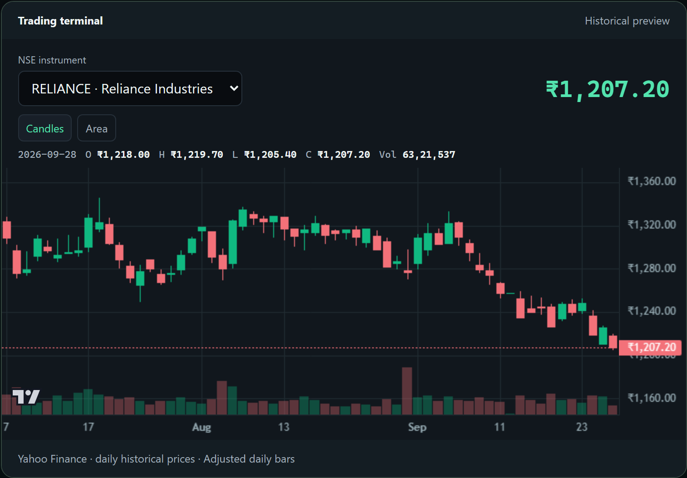

# Change log

## 2026-11-26 — TradeVelocity 2.0.1 demo release

- Publish the shared paper-trading terminal, virtual portfolio, market research, and AI Analyst as version 2.0.1.
- Rebuild the Windows x64 portable EXE, macOS ZIPs for Apple silicon and Intel, and the Android APK. The Android package uses build number 4.
- Apply the selected Light, Dark, or System theme across sign-in, the trading workspace, and the admin dashboard. Android also saves its theme selection and applies it to the account screens, system bars, and navigation.
- Publish the latest demo and its checksums in [GitHub Releases](https://github.com/sgshiv001/TRADE-VELOCITY/releases/tag/v2.0.1). iPhone and iPad use the Safari web app.
- Email-code signup remains pending provider setup.

## Earlier development

The original log recorded the project implemented through 2 October 2026. Original
commit dates are taken from Git. Later milestones summarize the development
session and current files; they do not imply separate commits existed for every
intermediate edit. See [the detailed development log](docs/development-log.md)
and `git log --all --stat` for the full available record.

## 2026-10-19 — Prepare TradeVelocity 0.3.4 for manual testing

- Add a cinematic CSS 3D visualization of the actual selected symbol's order
  book, with readable best bid/ask, last-match information, and an honest empty
  state when no orders are resting.
- Keep the primary order-entry action prominent, improve button and input target
  sizes, and retain a responsive layout, light/dark themes, and reduced-motion
  support.
- Guard theme/watchlist preferences when browser storage is blocked. Pause live
  polling while offline and restart the WebSocket cleanly when connectivity
  returns.
- Production frontend build passed. Browser tests and native Windows smoke have
  not been rerun for this update; manual acceptance is pending.

## 2026-10-28 — Windows app icon and cinematic startup

- Add a branded multi-size TradeVelocity icon to the Windows executable and
  native app window. Introduce an animated startup screen that waits for the
  local workspace, displays its connection status, and fades into the app.
- Verify reduced-motion support, startup handoff, and packaged Windows icon.
- Rebuild the local Windows x64 folder and ZIP; keep this candidate unsigned and
  unpublished for manual acceptance.
- Follow-up verification: production frontend build passed; **160 Python tests**
  and **13 browser tests** passed; packaged smoke confirmed icon, startup
  handoff, matching, live workspace updates, AI calibration, and the high-volume
  regression.

## 2026-10-28 — Publish the Windows 0.3.4 pre-release

- Publish the tested portable Windows x64 ZIP as a GitHub pre-release, keeping
  the 115 MiB binary out of Git source history.
- Link the download and current verification details from the README and release
  notes; update the repository About text to describe the Windows/web app.
- The package is unsigned and labeled for testing; user manual acceptance on a
  second PC remains pending.

## 2026-10-28 — UI motion polish and verification

- Add smooth route-entry and staggered card transitions, refined hover/focus
  feedback, and subtle motion to the 3D order-book scene while keeping controls
  clear and readable.
- Respect reduced-motion preferences by disabling decorative animations and
  smooth scrolling.
- Rebuild the portable Windows x64 package with the updated frontend.
- Verification: production frontend build passed; **159 Python tests** and
  **12 browser tests** passed; packaged Windows smoke passed for matching, live
  workspace updates, AI calibration, and the high-volume regression. The
  candidate remains unsigned and user manual acceptance is pending.

## 2026-10-03 — Prepare Windows 0.3.3 locally before manual acceptance

- Rebuild the full portable Windows app from the current source; do not create
  a GitHub release, upload binaries, deploy, commit, or push this preparation.
- Include `START-HERE.txt` with direct launch and safe matching/restart/export
  checks using a separate custom symbol without clearing existing records.
- Repair the obsolete explicit SansIO hidden-import name by reading Uvicorn's
  installed protocol mapping in the build specification. Its standard hook
  already collected the implementation; this removes the misleading build error.
- Strengthen native smoke to require live WebSocket UI status as well as
  frontend rendering, matching and AI checks. Add receipt assertion coverage.
- Verification: **159 Python tests in 20.45 seconds**, **10 browser tests in
  17.0 seconds**, production UI build and actual frozen native smoke passed.
  Run with isolated writable storage and Python/Node excluded from PATH. The
  app releases its own port and preserves normal user data.
- Retain the regenerated CRC/SHA-256 manifest and local acceptance receipt in
  `dist/`; preserve older reports with their original dates/hashes. Signing and
  different-PC validation remain outstanding. User testing/publication are pending.

## 2026-10-02 — Publish the tested local application and repository presentation

- Update the README with verified Windows/web status, exact local test counts,
  launch/build instructions, actual light/dark screenshots, team credits, and
  clear boundaries rather than an unsupported zero-defect claim.
- Prepare publication to the existing public `sgshiv001/TRADE-VELOCITY` main
  branch, including current app source, tests, measured results and guides.
- Refresh the repository About description/topics to match Windows desktop,
  local web matching, persistent sessions and advisory AI analytics.
- Keep generated builds, dependencies, saved sessions, credentials and unrelated
  coursework out of Git. Generalize the machine-specific temporary path in
  published evidence and remove links to ignored local build outputs.
- Local app verification is unchanged: 159 Python tests, 10 browser tests and
  frozen Windows smoke passed. Remote CI status is separate and is available
  on GitHub Actions; source publication does not deploy the application.

## 2026-10-02 — Local release hardening and watchdog v3, application 0.3.3

Implementation and verification ran on 1 October; the completion report and
final documentation were finished on 2 October (India time).

- Repair the previous high-volume AI miss with a fixed raw-count envelope and
  require robust corroboration for forest alerts. Select five settings using
  54 candidates on development data; retain the old evaluation as regression
  evidence and reserve new seeds 3000–3031 only after selection.
- Controlled fresh result: 1,536/1,536 extreme deviations detected, zero false
  alerts among 15,360 normal controls. Explicit guards account for most alerts;
  these finite synthetic results do not establish real-market fraud accuracy.
- Use a supported Selector event loop and SansIO WebSocket transport on Windows;
  repeated reconnect/disconnect checks no longer reproduce WinError 10054.
- Add local Host/origin/client restrictions, bounded requests and payloads,
  security headers, and optional single-operator access-key/cookie protection.
  Prepare non-root Docker/Caddy HTTPS templates without deploying them.
- Add read-only Windows/WebView2/.NET diagnostics, fail clearly on missing
  prerequisites, and prepare certificate-store signing with verification and
  dry-run support. The current portable executable remains unsigned.
- Build a verified portable ZIP with CRC and SHA-256 manifest. Run the frozen
  application from a fresh folder with spaces and isolated writable data,
  excluding Python/Node from PATH. Native matching, UI rendering, both AI
  regressions, clean shutdown, and occupied-port recovery pass.
- Final checks: **159 Python tests in 29.84 seconds**, **10 browser tests in
  19.7 seconds**, production UI build, healthy Python requirements, and zero
  known npm vulnerabilities. The browser gate test uses a UI fixture; real
  API/cookie/WebSocket controls have separate in-process tests, not live TLS QA.
- Publish the local [completion/test report](docs/completion-report.md), current
  [AI report](docs/ai-calibration-report.md), and Windows/private-hosting guides.
  Preserve the v2 report and measurements. No signing, deployment, purchase,
  GitHub push, or user-session clearing occurred. Automated cleanup of the
  generated temporary extraction was blocked; its location is in the report.

## 2026-10-01 — Calibrated execution watchdog, application 0.3.2

- Split the fixed 40-execution baseline into 24 fitting and 16 cutoff
  observations. Combine Isolation Forest with explicit robust-deviation guards,
  log-transformed count/depth features, fixed-cutoff severity, and detector labels.
- Select forest margin 0.08, robust floor 6.0, and padding 1.0 on development
  workloads only. Package the selected settings for Windows and browser modes.
- Add an isolated reproducible evaluator with 16 candidates, separate held-out
  seeds, comparison to the old method, detector attribution, and all error cases.
- Held-out controlled result: 767/768 deviations detected, 6/7,680 normal
  controls falsely flagged; precision 99.22%, recall 99.87%. Explicit guards
  account for most detections. One high-volume miss is retained and documented;
  these are not real-market fraud accuracy figures.
- Cover the original repetitive-baseline miss in Python, browser, and packaged
  Windows checks; verify AI reporting does not change matching records.
- Repair WebSocket disconnect cleanup exposed by the complete suite and add
  repeated-disconnection coverage. Preserve request cancellation semantics.
- Verification: 124 Python tests, 5 browser tests, production UI build, dependency
  checks, and native Windows smoke passed. See the
  [archived v2 calibration report](docs/ai-calibration-v2-report.md) for warnings and limits.
- Update README, architecture, evaluation references, and local Windows build.
  No user session was seeded/cleared; no GitHub push was performed.

## 2026-09-30 — Windows and web matching workspace without presets

- Replace the presentation interface with operational overview, order entry,
  depth, market history, execution monitoring, full trade history, and measured
  performance tools. Both modes use the same engine and application source.
- Remove demoapp.py, classroom generators and APIs, injected trading sessions,
  generated-price fallback, and illustrative data-structure/analytics screens.
  New sessions are empty; saved records are preserved rather than erased.
- Add order amendments, custom symbols, full-history search/pagination and CSV
  export, plus session import with confirmation and engine replay validation.
- Refresh actual provider history into writable application storage. Missing
  history stays unavailable; failed refreshes preserve orders and cached data.
- Remove virtual-account operations from the app; preserve legacy account data
  on disk. Execution remains local, without a broker or real-money transfers.
- Update Windows packaging, VS Code configurations, README, and architecture.
- Verification: production frontend build; 93 tests passed; packaged smoke exit
  0 with 7 matched shares and 1 trade; real Windows window opened and shut down;
  browser matching/amendment/history, provider refresh, analysis, and themes
  checked. The provider returned history dated 30 September 2026.

## 2026-09-29 — Readable dropdowns in dark mode

- Apply the dark color scheme to native select menus and set option text and
  background colors explicitly, including the company picker and other lists.
- Rebuild and visually check the Windows desktop app with the company menu open.

## 2026-09-29 — Complete automated build checks

- Build the production React interface once on GitHub Actions and pass that
  build to every Python test job, so launcher integration checks can run.
- Run the full Python suite on Ubuntu and Windows with Python 3.11 and 3.13;
  install the desktop runtime on Windows so desktop lifecycle tests run there.
- Show the current workflow status in the README.

## 2026-09-29 — Repository presentation

- Refresh the README with a concise project overview, clear safety boundary,
  technology badges, faster setup instructions, and direct links to the demo,
  architecture, measured results, and development history.
- Add an accessible, repository-native SVG illustrating order entry, matching,
  simulation, and the separate AI execution watchdog.
- Explain the TradeVelocity name and the order-matching problem in plain language;
  clarify that AI flags unusual simulated executions for human review and does not
  make trading or matching decisions.

## 2026-09-29 — Desktop app, professional themes, and execution watchdog

- Add an optional native Windows desktop window through `app.py --desktop`,
  folder launch via `Launch_Desktop.vbs`, a portable PyInstaller build, and a
  generated TV icon. Bundle Python and the built UI; retain browser mode.
- Persist desktop sessions under `%LOCALAPPDATA%\TradeVelocity`; bind only to
  loopback, fall back from occupied ports, and stop the owned server on close.
- Default to a clean light interface, add a saved slate dark theme, rounded
  cards, improved typography, keyboard focus indicators, responsive forms,
  and local font fallbacks without external font downloads.
- Fingerprint desktop entry URLs and avoid cached entry HTML/API state after
  rebuilding, while preserving saved accounts and theme preferences.
- Replace animated simulator estimates with backend order execution controlled
  by scenario, seed, quantity, buy probability and market-order percentage.
- Add a manual buy/sell order ticket, cancellation controls, complete session
  export, and a confirmed lab reset. Clearly label the newest-100-trade view.
- Monitor actual execution features with a fixed 40-observation baseline;
  never fit on the later scored observations. Keep historical AI separate.
- Add a repeatable classroom demo: 40 training and 50 held-out observations,
  including 10 injected spikes. On this machine: 10 detected, 0 missed, 7 false
  alarms, 33 correct normal observations; synthetic precision 58.8%, recall 100%.
- Add real in-app indexed/linear benchmark execution and export. Retain earlier
  benchmark evidence; save this run separately as `desktop-comparison.csv`.
- Verify 96 local tests, including actual API calls with desktop lifecycle
  checks. Native and packaged-window verification is recorded in the log.

## 2026-09-29 — Add a Windows double-click shortcut

- Add `Launch_TradeVelocity.bat` in the existing project folder at the user's
  request. It delegates to `app.py` rather than duplicating the application.
- Use the project `.venv` and the launcher's own directory, including paths with
  spaces. Keep browser selection, forward command-line options, and leave
  startup/setup errors visible in the window.
- Keep `app.py` and `demoapp.py` as the only Python entry files. Update README
  with the double-click instructions.
- Ensure batch files use CRLF line endings on checkout. Add Windows checks for
  paths with spaces, another working directory, missing setup, option forwarding
  and preservation of Python error codes. Full local suite: **85 passed**.

## 2026-09-29 — Simplify launch files and project presentation

- Use the name **TradeVelocity** with the full title **High-Performance Stock
  Market Order Matching Engine with Advanced Data Structures, Market Simulation
  and AI Analytics**.
- Keep `app.py` as the full-app launcher; rename the presentation entry to
  `demoapp.py` and add verified price/FIFO/partial-fill/cancellation/VWAP examples.
- Update VS Code run/demo configurations and launcher regression paths.
- Remove batch/compatibility launchers, the phase-1 setup entry/configuration,
  duplicate requirements list, legacy Streamlit dashboard and its tests, and
  obsolete guides/problem-statement file.
- Remove empty output placeholders, an outdated screenshot, unused chart code,
  unused AI page, and unused Recharts/Streamlit dependencies. Python dependencies
  now have one source of truth in `pyproject.toml`.
- Shorten README with the meaning of the project name, the problem being solved,
  two run commands, a compact structure, and clear feature limitations.
- Keep the matching engine, API, historical data, benchmark evidence, current
  tests, and complete Git history. Removed files remain recoverable from Git;
  no new backup folder is created.
- Update the existing public GitHub repository's description and topics without
  creating or renaming a repository.
- Validation: **83 tests passed**, TypeScript/Vite production build succeeded,
  both entry files served the built UI and released their ports, and the
  terminal demo passed all matching checks. See the development log for details.
- Automatic approval review blocked removal of leftover local cache/empty
  directories. These directories are not part of the GitHub upload.

## 2026-09-29 — Consolidate the single project folder

- Clarified that the original `ADSA PROJECT` working folder and Trade Velocity
  are the same project, not separate applications.
- Verified all 83 tracked files in the nested checkout matched the original
  checkout, apart from Windows line endings; no unique edits required merging.
- Removed the nested checkout from the working project. The original root
  retains all source, Git history/remote, Python environment, frontend
  dependencies, and local sessions.
- Updated README/contribution guidance to use the original single working root.
- A temporary duplicate backup was created before the user clarified that no
  backup should remain. Its deletion was requested and attempted, but automatic
  command policy rejected removal. It remains outside the project pending manual
  deletion; the project itself has no nested duplicate.

## 2026-09-29 — Complete launcher and GitHub publication

### Added

- Root `app.py` to run the complete React + FastAPI application.
- Browser selection for Edge, Chrome, Firefox, and the system default, plus
  `--browser`, `--no-browser`, `--port`, and `--skip-build` options.
- Windows `app.bat`, and compatibility through `run_app.bat` and
  `scripts/run_app.py`.
- Startup dependency checks with a project-interpreter installation command.
- `tests/test_launcher.py` covering other occupied services, reuse of an
  existing app, missing-browser fallback, frontend serving, and server cleanup.
- Comprehensive current README, this change log, detailed development log,
  contribution instructions, and a documented future-update workflow.

### Changed and fixed

- VS Code **Trade Velocity: Run App** now launches root `app.py` with the
  project's `.venv` and an interactive integrated terminal.
- The run task uses a process command with separate arguments, avoiding a
  quoted executable being misinterpreted by PowerShell.
- The classroom launcher delegates server/browser handling to the shared
  launcher after its deterministic walkthrough.
- Uvicorn runs in the selected interpreter's server process instead of a
  detached child of the former build runner. Stopping the configured VS Code
  launcher releases the server port.
- System-Python launches delegate to `.venv` with properly quoted arguments;
  this fixes paths containing spaces and preserves the child exit status.
- The launcher reserves its port before building, reports occupied ports, and
  reuses only a health response identifying this application.
- `/api/health` now includes `application: trade-velocity`.
- Browser opening happens after server startup. Missing browser executables
  fall back to the system browser; failures retain a usable local URL.
- Git excludes local session journals, environments, dependencies, build
  caches, `.env` files, the embedded clone, and unrelated coursework.
- CI's frontend job also runs launcher checks against its real production
  build; the port-release assertion handles Windows/Linux socket semantics.
- The existing `sgshiv001/TRADE-VELOCITY` remote is used. Original engine history
  and the GitHub repository's initial commit are retained without a force push.

### Validation

- Frontend production build succeeded during launcher verification.
- Targeted launcher/API run: **13 passed**; launcher checks were rerun after the
  Windows delegation fix: **4 passed**.
- A full launcher built the UI and served `/`, `/api/health`, and market data for
  eight companies. Ctrl+C completed application shutdown.
- A smoke run through the VS Code extension's bundled debugpy also started and
  stopped successfully. These checks do not imply every UI interaction was
  browser-tested.
- Publication validation: **85 tests passed in 13.16 seconds**, production
  frontend build succeeded, dependency check passed, and the demo scenario
  replayed with nine events/four trades. See the detailed development log.
- Published 83 project files to the existing public repository's `main` branch.
  Implementation commit: `c331e27`; history-integration merge: `4e159b8`.
  GitHub's remote SHA and file tree were verified after the successful push.
  GitHub Actions started for that push; local results above are separate from
  its eventual hosted CI result.

## 2026-09-28 to 2026-09-29 — Historical AI and runtime fixes

### Added

- `anomaly.py`: 13-feature OHLCV preparation, StandardScaler, and a 150-tree
  Isolation Forest with seed 42.
- Normalized display scores, model flags, latest feature vector, recent
  timeline, and historical-proxy descriptions.
- `GET /api/ai/anomalies/{symbol}` and active React AI Monitor integration.
- `tests/test_anomaly.py` for feature preparation and anomaly reports.
- Deterministic `class_demo.py` with multi-price matching, VWAP, and partial
  execution, plus terminal-only rehearsal and presentation guidance.

### Fixed

- Test dependencies switched to `httpx2>=2,<3` for the installed Starlette
  TestClient, removing its non-blocking httpx deprecation warning in the tested
  environment.
- Python app dependencies include Uvicorn, FastAPI, NumPy, pandas, scikit-learn,
  and yfinance; launch configuration uses the project interpreter.
- Classroom terminal output uses ASCII-safe separators for Windows consoles.
- Running development servers were stopped after port-8000 contention was
  identified. The later shared launcher provides explicit occupied-port checks.

### Limitations recorded

- Historical order-flow fields are proxies, not observed exchange orders.
- The model fits and scores the same window; displayed unusualness is neither
  fraud probability nor validated forecasting accuracy.
- The displayed top features are standardized deviations, not causal/model
  attributions.
- The original debugger-specific missing-Uvicorn error was not reproduced in
  the old runner; the shared launcher now uses direct imports and was verified
  under bundled debugpy.

## 2026-09-28 — React application, data, experiments, and academic setup

### Application and market data

- Added FastAPI routes for sessions, matching lab, account actions, history,
  analysis, and recorded/fresh experiments.
- Added the React/TypeScript/Vite client, typed API helpers, charts, CSS, favicon,
  and locked npm dependency file.
- Implemented the initial MarketLab company/portfolio interface, then redesigned
  the active layout as the dark Trade Velocity engine laboratory with landing
  page, responsive sidebar, and eight navigation pages.
- Added profiles and dated history for eight NSE companies, adjusted-price
  indicators, provider refresh, snapshot serialization, and explicit simulated
  fallback handling.
- Added a Decimal-based paper broker with synthetic liquidity, cash/holdings,
  realized/unrealized P/L, and atomic local account/lab session journals.
- Added rule-based historical insight generation separate from matching.

### Core structures and measurements

- Added separate-chaining hash tables for order IDs and direct price-level
  lookup, with growth/shrink behavior and cached hashes.
- Added bottom-up heap construction, linear Fenwick-capacity rebuilds, and
  tests for structure invariants, collisions, lifecycle operations, churn,
  reference matching, and concurrency.
- Added an unsorted-list price-book comparison engine, controlled mixed/deep/
  cancellation workloads, final-outcome verification, alternating timed runs,
  and separate memory measurements.
- Recorded `benchmarks/custom-structures.csv` and `benchmarks/comparison.csv`.
  Updated architecture, complexity, evaluation, and measured-result reports.
  Results include workloads where lists have lower overhead.

### Academic setup and documentation

- Added central `config/settings.py`, root `main.py` setup check, supplemental
  `requirements.txt`, MIT license, and phase-1 documentation/tests.
- Added placeholder directories for raw/processed/generated data, benchmark
  outputs, and report figures/results.
- Added problem statement, app/demo/classroom guides, and a screenshot from
  the earlier MarketLab layout.
- Expanded GitHub Actions to cover the Python application/dashboard and frontend.

### Current UI limitations

- DSA diagrams are illustrative; they do not instrument the engine's actual
  mutations or provide verified AVL rotation traces.
- Simulator controls animate counters rather than submitting that configured
  workload. Actual concurrent submissions are available through the CLI.
- Some analytics graphics are illustrative. The current frontend does not expose
  all paper-account/manual-order capabilities implemented by the API.
- Recorded benchmark CSVs and reports are the authoritative measurement
  evidence; the frontend's benchmark table does not normalize every CSV schema.

## 2026-09-28 — Existing GitHub repository initialized

- GitHub repository `sgshiv001/TRADE-VELOCITY` initially contained a heading-only
  README and `.gitattributes`.
- Commit: `1814dfc0b681fe7799ee9dbaf0ac4f198820f379`, **Initial commit**,
  recorded at 23:55:05 +05:30. This separate repository history is retained.

## 2026-09-24 — Complete stock matching engine project

- Commit: `4c84a91`, recorded at 15:55:29 +05:30.
- Added scenario sessions and JSON replay, example scenario, repeated benchmark
  script and baseline CSV, dashboard/session tests, and GitHub Actions.
- Expanded the dashboard, CLI, matching implementation, README, and design,
  evaluation, and results documentation.
- Git records **17 files changed, 800 insertions, 134 deletions**.

## 2026-09-24 — Initial stock order matching engine

- Commit: `67a4520`, recorded at 11:59:49 +05:30.
- Added Python package/configuration, matching/order models, custom structure
  implementations, CLI demonstration, initial Streamlit dashboard, README,
  ignored development artifacts, and engine tests.
- Git records **10 files changed, 1,073 insertions**.

## Future updates

Add a dated entry describing each meaningful change and its verification.
Use Git commits for exact file diffs and [CONTRIBUTING.md](CONTRIBUTING.md) for
the update procedure. Do not claim an automatic transcript of uncommitted edits.
# TradeVelocity

TradeVelocity is a paper trading simulator we built for our Advanced Data Structures and Algorithms project at Bennett University. In the 2.0.1 demo release, you can start with ₹10 lakh in virtual funds, place limit orders, and see how the shared order book handles each fill. PostgreSQL saves accounts, orders, and portfolio records across supported devices. All trading is simulated.

[Open the live app](https://gettradevelocity.onrender.com) · [Download v2.0.1](https://github.com/sgshiv001/TRADE-VELOCITY/releases/tag/v2.0.1) · [Project website](https://sgshiv001.github.io/TRADE-VELOCITY/) · [Presentation demo](docs/adsa-demo.md)



## Try a paper trade

1. [Create a trader account](https://gettradevelocity.onrender.com/signup) and follow or skip the first-run tutorial. You can reopen it from **Help**.
2. Open the **Trading terminal**, choose a supported stock, and check its reference price and **Market depth**. Enter a share quantity and limit price, then review and confirm the order.
3. Check **Orders**, **Trade history**, and **Portfolio** to see what filled, what remains open, and how the fill changed your virtual balance.

For a partial-fill demo, open two trader accounts in separate browsers. Place a resting bid for 10 shares. Then use the other account, which needs at least 5 shares of the same stock, to sell 5 at the bid price. If the resting order is first in line, 5 shares fill and the remaining 5 stay on the book. The [demo guide](docs/adsa-demo.md) walks through the setup.

## What you can explore

| Area | What you can do |
| --- | --- |
| Trading terminal | See simulated bids and asks, place confirmed limit orders, and inspect fills and open orders. |
| Market research | Browse supported NSE stocks, check timestamped price references, study historical charts, and save watchlists. Provider quotes may be delayed. |
| Portfolio and funds | Track virtual cash, reservations, holdings, and executions. |
| AI Analyst and Assistant | Explore technical indicators, view forecast ranges when available, and get explanations of the evidence. |
| Admin dashboard | Authorized admins can view account activity and service status. |

The [matching engine](src/stock_engine/) uses heaps for best-price lookup, AVL trees for ordered depth, FIFO queues at each price, hash tables for order lookup, and a Fenwick tree for volume queries. The [architecture notes](docs/architecture.md) explain the trade-offs and complexity. This is an educational simulator with no brokerage connection.

## Downloads

| Device | Open or download | Preview details |
| --- | --- | --- |
| Web | [Open TradeVelocity](https://gettradevelocity.onrender.com) | The free host may take a moment to wake up. |
| Windows x64 | [Download the portable EXE](https://github.com/sgshiv001/TRADE-VELOCITY/releases/download/v2.0.1/TradeVelocity-Trader.exe) | Unsigned preview connected to the hosted app. |
| macOS | [Apple silicon](https://github.com/sgshiv001/TRADE-VELOCITY/releases/download/v2.0.1/TradeVelocity-macOS-arm64.zip) · [Intel](https://github.com/sgshiv001/TRADE-VELOCITY/releases/download/v2.0.1/TradeVelocity-macOS-x64.zip) | Desktop ZIP previews with Apple notarization pending. |
| Android | [Download the APK](https://github.com/sgshiv001/TRADE-VELOCITY/releases/download/v2.0.1/TradeVelocity-Android.apk) | Debug-signed test build for Android 7 and later. |
| iPhone and iPad | [Safari installation guide](https://gettradevelocity.onrender.com/download) | Install the web app through Safari. |

See the [2.0.1 release notes](https://github.com/sgshiv001/TRADE-VELOCITY/releases/tag/v2.0.1) and the [downloads page](https://gettradevelocity.onrender.com/download) for installation details and file checksums. Android launch was checked on an emulator, and both Mac packages were validated on build runners. Live email-code signup is pending email delivery setup.

## Run it locally

Use Python 3.10+, Node.js 22, and pnpm 11.25.0. From the repository root in PowerShell:

~~~powershell
python -m venv .venv
.\.venv\Scripts\python.exe -m pip install -e ".[app,test,postgres,accounts]"
pnpm install --frozen-lockfile
pnpm build:web
$env:TRADEVELOCITY_WEB_DIR = Join-Path (Get-Location) 'apps/web/out'
.\.venv\Scripts\python.exe scripts/browser_test_server.py --port 8804
~~~

Open `http://127.0.0.1:8804` for the local practice workspace. See [hosted setup](docs/hosted-workspace.md) for PostgreSQL and connected accounts, and the [2.0 release guide](docs/tradevelocity-2.0.md) for staging and deployment.

Run the Python tests with `.\.venv\Scripts\python.exe -m pytest -q` and the shared client tests with `pnpm test:shared`. [GitHub Actions](https://github.com/sgshiv001/TRADE-VELOCITY/actions) shows current build and test results.

## Team

We are **Hash Syndicate**. We built TradeVelocity together and focused on these areas of the project.

| Member | Project contribution |
| --- | --- |
| Shivanshu Gupta | Project concept, application design, core order-matching engine, and admin dashboard |
| Aditya Verma | Backend development, database integration, and support for app operations |
| Sourabh Gupta | Trading frontend development and testing of order placement and execution |
| Harshit Sharma | AI feature development and model training for the in-app assistant |

[Team page](docs/team.md) · [Evaluation results](docs/evaluation.md) · [AI calibration](docs/ai-calibration-report.md) · [Development log](docs/development-log.md) · [MIT license](LICENSE)
{
  "name": "@tradevelocity/desktop",
  "version": "2.0.1",
  "private": true,
  "description": "TradeVelocity desktop paper trading client",
  "author": "TradeVelocity",
  "type": "module",
  "main": "dist/main.js",
  "scripts": {
    "build": "tsc -p tsconfig.json",
    "dev": "pnpm build && electron .",
    "package": "pnpm build && electron-builder",
    "package:windows:admin": "electron-builder --config electron-admin.yml --win portable --x64",
    "package:windows:trader": "electron-builder --config electron-trader.yml --win portable --x64"
  },
  "devDependencies": {
    "@types/node": "^22.0.0",
    "electron": "45.5.0",
    "electron-builder": "26.18.0",
    "typescript": "~5.9.3"
  }
}
{
  "expo": {
    "name": "TradeVelocity",
    "slug": "tradevelocity",
    "scheme": "tradevelocity",
    "version": "2.0.1",
    "icon": "./assets/icon.png",
    "orientation": "default",
    "userInterfaceStyle": "automatic",
    "android": {"package": "com.tradevelocity.nativeapp", "versionCode": 4, "adaptiveIcon": {"foregroundImage": "./assets/adaptive-icon.png", "backgroundColor": "#090c10"}},
    "ios": {"bundleIdentifier": "com.tradevelocity.nativeapp", "buildNumber": "4", "supportsTablet": true},
    "plugins": [
      "expo-router",
      "expo-secure-store",
      ["expo-local-authentication", {"faceIDPermission": "Unlock your TradeVelocity session."}],
      "./plugins/with-windows-cmake.cjs"
    ]
  }
}
import { Tabs } from "expo-router";
import { SafeAreaProvider } from "react-native-safe-area-context";
import { StatusBar } from "expo-status-bar";
import { MobileAppearance, MobileSession, useMobileTheme } from "../src/workspace";

export default function Layout() {
  return <MobileAppearance><AppLayout /></MobileAppearance>;
}

function AppLayout() {
  const {colors, mode} = useMobileTheme();
  return <SafeAreaProvider style={{backgroundColor: colors.background}}><StatusBar style={mode === "dark" ? "light" : "dark"} />
    <MobileSession>
      <Tabs screenOptions={{sceneStyle: {backgroundColor: colors.background}, headerStyle: {backgroundColor: colors.background}, headerTintColor: colors.text,
        tabBarStyle: {backgroundColor: colors.panel, borderTopColor: colors.line}, tabBarActiveTintColor: colors.action, tabBarInactiveTintColor: colors.muted}}>
        <Tabs.Screen name="index" options={{title: "Home"}} />
        <Tabs.Screen name="markets" options={{title: "Markets"}} />
        <Tabs.Screen name="trade" options={{title: "Trade"}} />
        <Tabs.Screen name="analyst" options={{title: "AI Analyst"}} />
        <Tabs.Screen name="portfolio" options={{title: "Portfolio"}} />
      </Tabs>
    </MobileSession>
  </SafeAreaProvider>;
}
import { useState } from "react";
import { Text, View } from "react-native";
import { Action, MobileThemePicker, Screen, useMobileTheme, useWorkspace } from "../src/workspace";
import { formatINR, type ExecutionInbox, type Portfolio } from "@tradevelocity/client";
import { useData } from "../src/data";

export default function Home() {
  const {theme} = useMobileTheme();
  const {trader, signOut, enableLock, request} = useWorkspace();
  const portfolio = useData<Portfolio>("/account/portfolio");
  const inbox = useData<ExecutionInbox>("/account/notifications");
  const [notice, setNotice] = useState("");
  function action(operation: () => Promise<unknown>, success: string) {
    void operation().then(() => setNotice(success)).catch(error => setNotice(String(error)));
  }
  return <Screen title="Overview" refresh={() => { portfolio.refresh(); inbox.refresh(); }}>
    <Text style={theme.subtle}>Signed in as {trader.username} · INR paper trading</Text>
    {portfolio.error && <Text style={theme.error}>{portfolio.error}</Text>}
    {portfolio.data && <View style={theme.panel}>
      <Text style={theme.subtle}>Virtual account value</Text><Text style={theme.title}>{formatINR(portfolio.data.equity)}</Text>
      <Text style={theme.text}>{formatINR(portfolio.data.available_cash)} available</Text>
    </View>}
    <View style={theme.panel}>
      <Text style={theme.text}>Execution inbox · {inbox.data?.unread ?? "—"} unread</Text>
      {inbox.error && <Text style={theme.error}>{inbox.error}</Text>}
      {inbox.data?.items.slice(0, 5).map(item => <Text key={item.id} style={theme.subtle}>{item.symbol} · {item.quantity} shares · {formatINR(item.price)}</Text>)}
      {Boolean(inbox.data?.unread) && <Action title="Mark all as read" onPress={() => action(async () => {
        await request("/account/notifications/read", {method: "POST"});
        inbox.refresh();
      }, "Inbox updated")} />}
    </View>
    <MobileThemePicker />
    <Action title="Enable biometric unlock" onPress={() => action(enableLock, "Device lock preference saved")} />
    <Action title="Sign out" onPress={() => action(signOut, "")} />
    {notice && <Text accessibilityLiveRegion="polite" style={theme.subtle}>{notice}</Text>}
  </Screen>;
}
{
  "name": "@tradevelocity/mobile",
  "version": "2.0.1",
  "private": true,
  "main": "expo-router/entry",
  "scripts": {
    "start": "expo start",
    "typecheck": "tsc --noEmit",
    "export:android": "expo export --platform android"
  },
  "dependencies": {
    "@tradevelocity/client": "workspace:*",
    "expo": "~58.0.26",
    "expo-constants": "~58.0.16",
    "expo-linking": "~58.0.17",
    "expo-local-authentication": "~58.0.3",
    "expo-router": "~58.0.32",
    "expo-secure-store": "~58.0.3",
    "expo-status-bar": "~58.0.5",
    "expo-system-ui": "~58.0.7",
    "react": "19.3.0",
    "react-native": "0.88.1",
    "react-native-safe-area-context": "~5.8.0",
    "react-native-screens": "~4.30.1"
  },
  "devDependencies": {
    "@types/react": "^19.2.0",
    "typescript": "~5.9.3"
  }
}
import { createContext, useContext, useEffect, useRef, useState, type ReactNode } from "react";
import { Appearance, AppState, Pressable, RefreshControl, ScrollView, StyleSheet, Text, TextInput, View, useColorScheme } from "react-native";
import * as LocalAuthentication from "expo-local-authentication";
import * as SecureStore from "expo-secure-store";
import { SafeAreaView } from "react-native-safe-area-context";
import { createClient, TradeVelocityApiError, type Trader } from "@tradevelocity/client";

const origin = process.env.EXPO_PUBLIC_API_URL ?? "https://gettradevelocity.onrender.com";
if (!/^https:\/\/[a-z\d.-]+(?::\d+)?\/?$/i.test(origin)) throw new Error("The mobile API must be an HTTPS origin");
const sessionKey = "tradevelocity-auth-v1";
const biometricKey = "tradevelocity-device-lock-v1";
type Session = {token: string; trader: Trader};
type Request = ReturnType<typeof createClient>;
const SessionContext = createContext<{request: Request; trader: Trader; signOut(): Promise<void>; enableLock(): Promise<void>; revision: number} | null>(null);
export function useWorkspace() {
  const session = useContext(SessionContext);
  if (!session) throw new Error("Sign in to TradeVelocity");
  return session;
}

const palettes = {
  dark: {background: "#090c10", panel: "#11171d", line: "#26303a", text: "#eff5f4", muted: "#a2b0bc", action: "#35d69e", onAction: "#09271e", error: "#f99099"},
  light: {background: "#f3f6f5", panel: "#ffffff", line: "#d9e3e0", text: "#15211f", muted: "#4e605b", action: "#056349", onAction: "#ffffff", error: "#ad2b3b"},
};
function createTheme(colors: typeof palettes.dark) {
  return StyleSheet.create({
    screen: {flex: 1, backgroundColor: colors.background},
    section: {padding: 18, gap: 13},
    panel: {backgroundColor: colors.panel, borderRadius: 10, padding: 15, gap: 8, borderWidth: 1, borderColor: colors.line},
    title: {color: colors.text, fontSize: 31, fontWeight: "700", letterSpacing: -1.1},
    text: {color: colors.text, fontSize: 16},
    subtle: {color: colors.muted, fontSize: 14},
    error: {color: colors.error, fontSize: 14},
    field: {backgroundColor: colors.panel, borderWidth: 1, borderColor: colors.line, borderRadius: 8, color: colors.text, minHeight: 48, paddingHorizontal: 12},
    action: {backgroundColor: colors.action, borderRadius: 8, padding: 13, alignItems: "center"},
    actionText: {color: colors.onAction, fontSize: 16, fontWeight: "700"},
    link: {color: colors.action, fontSize: 15, paddingVertical: 8, fontWeight: "600"},
  });
}
const themes = {light: createTheme(palettes.light), dark: createTheme(palettes.dark)};
type ThemeOption = keyof typeof themes | "system";
const themeKey = "tradevelocity-theme-v1";
const themeOptions = [
  {value: "system", label: "System"},
  {value: "light", label: "Light"},
  {value: "dark", label: "Dark"},
] as const;
const ThemeContext = createContext<{selection: ThemeOption; select(value: ThemeOption): void}>({
  selection: "system", select: () => {},
});

export function MobileAppearance({children}: {children: ReactNode}) {
  const [selection, select] = useState<ThemeOption | null>(null);
  useEffect(() => {
    let active = true;
    void SecureStore.getItemAsync(themeKey).then(saved => {
      if (!active) return;
      const value = themeOptions.find(option => option.value === saved)?.value ?? "system";
      select(current => current ?? value);
    }).catch(() => {});
    return () => { active = false; };
  }, []);
  useEffect(() => {
    if (selection === null) return;
    Appearance.setColorScheme(selection === "system" ? "auto" : selection);
    void SecureStore.setItemAsync(themeKey, selection).catch(() => {});
  }, [selection]);
  return <ThemeContext.Provider value={{selection: selection ?? "system", select}}>{children}</ThemeContext.Provider>;
}

export function useMobileTheme() {
  const {selection} = useContext(ThemeContext);
  const system = useColorScheme() === "light" ? "light" : "dark";
  const mode = selection === "system" ? system : selection;
  return {theme: themes[mode], colors: palettes[mode], mode};
}

export function MobileThemePicker() {
  const {selection, select} = useContext(ThemeContext);
  const {theme, colors} = useMobileTheme();
  return <View style={theme.panel}>
    <Text style={theme.text}>Theme</Text>
    <View accessibilityRole="radiogroup" style={{flexDirection: "row", flexWrap: "wrap", gap: 8}}>
      {themeOptions.map(({value, label}) => {
        const selected = value === selection;
        return <Pressable key={value} accessibilityRole="radio" accessibilityState={{checked: selected}}
          onPress={() => select(value)} style={[theme.action, !selected && {
            backgroundColor: colors.background, borderColor: colors.line, borderWidth: 1,
          }]}>
          <Text style={selected ? theme.actionText : theme.text}>{label}</Text>
        </Pressable>;
      })}
    </View>
  </View>;
}

export function Screen({title, children, refresh}: {title: string; children: ReactNode; refresh?: () => void}) {
  const {theme, colors} = useMobileTheme();
  return <ScrollView style={theme.screen} contentContainerStyle={theme.section} keyboardShouldPersistTaps="handled"
    refreshControl={refresh ? <RefreshControl refreshing={false} onRefresh={refresh} tintColor={colors.action} colors={[colors.action]} progressBackgroundColor={colors.panel} /> : undefined}>
    <Text style={theme.title} accessibilityRole="header">{title}</Text>{children}
  </ScrollView>;
}

export function Action({title, onPress, disabled = false}: {title: string; onPress(): void; disabled?: boolean}) {
  const {theme} = useMobileTheme();
  return <Pressable accessibilityRole="button" accessibilityState={{disabled}} disabled={disabled}
    style={[theme.action, disabled && {opacity: 0.6}]} onPress={onPress}><Text style={theme.actionText}>{title}</Text></Pressable>;
}

function reason(error: unknown) {
  return error instanceof Error ? error.message : "The request could not be completed.";
}

export function MobileSession({children}: {children: ReactNode}) {
  const {theme, colors} = useMobileTheme();
  const [session, setSession] = useState<Session | null>(null);
  const [locked, setLocked] = useState(false);
  const [restoring, setRestoring] = useState(true);
  const [error, setError] = useState("");
  const [username, setUsername] = useState("");
  const [password, setPassword] = useState("");
  const [email, setEmail] = useState("");
  const [verifySignup, setVerifySignup] = useState(false);
  const [verificationToken, setVerificationToken] = useState("");
  const [emailCode, setEmailCode] = useState("");
  const [register, setRegister] = useState(false);
  const [busy, setBusy] = useState(false);
  const [revision, setRevision] = useState(0);
  const generation = useRef(0);
  const enteringCodes = register && verifySignup && Boolean(verificationToken);

  function clearVerification() {
    setVerificationToken("");
    setEmailCode("");
  }

  async function resume(token: string) {
    const current = ++generation.current;
    const result = await createClient(origin, {token})<{trader: Trader | null}>("/auth/status");
    if (current !== generation.current) return;
    if (!result.trader) {
      await SecureStore.deleteItemAsync(sessionKey);
      return;
    }
    setSession({token, trader: result.trader});
  }

  async function restore() {
    setError("");
    const token = await SecureStore.getItemAsync(sessionKey);
    if (!token) return;
    if (await SecureStore.getItemAsync(biometricKey)) {
      setLocked(true);
      return;
    }
    await resume(token);
  }

  useEffect(() => { void restore().catch(cause => setError(reason(cause))).finally(() => setRestoring(false)); }, []);
  useEffect(() => {
    if (!session) return;
    const onResume = AppState.addEventListener("change", state => {
      if (state === "active") setRevision(value => value + 1);
    });
    let stopped = false;
    let waiting = 0;
    let connection: WebSocket | null = null;
    let delay = 1000;
    const connect = () => {
      // React Native's WebSocket constructor accepts request headers as its third parameter.
      const Socket = WebSocket as unknown as new (url: string, protocols: string[], options: {headers: Record<string, string>}) => WebSocket;
      connection = new Socket(`${origin.replace(/\/$/, "").replace(/^https:/, "wss:")}/api/live?session_id=${encodeURIComponent(session.trader.workspace_id)}`, [],
        {headers: {Authorization: `Bearer ${session.token}`}});
      connection.onopen = () => { delay = 1000; };
      connection.onmessage = event => {
        try {
          const code = JSON.parse(String(event.data)).type;
          if (["connected", "changed", "exchange_changed"].includes(code)) setRevision(value => value + 1);
        } catch { /* An invalid event should not replace the current state. */ }
      };
      connection.onclose = () => {
        if (stopped) return;
        waiting = Number(setTimeout(connect, delay));
        delay = Math.min(15000, delay * 2);
      };
    };
    connect();
    return () => { stopped = true; clearTimeout(waiting); connection?.close(); onResume.remove(); };
  }, [session]);

  async function toggleRegistration() {
    setError("");
    clearVerification();
    if (register) {
      setRegister(false);
      return;
    }
    setBusy(true);
    try {
      const status = await createClient(origin)<{signup_verification_required?: boolean}>("/auth/status");
      setVerifySignup(Boolean(status.signup_verification_required));
      setRegister(true);
    } catch (cause) { setError(reason(cause)); }
    finally { setBusy(false); }
  }

  async function requestEmailCode() {
    setBusy(true); setError("");
    try {
      const result = await createClient(origin)<{verification_token: string}>("/auth/signup/start", {
        method: "POST", body: JSON.stringify({username: username.trim(), email: email.trim()}),
      });
      setEmailCode("");
      setVerificationToken(result.verification_token);
    } catch (cause) { setError(reason(cause)); }
    finally { setBusy(false); }
  }

  async function submit() {
    if (register && password.length < 12) {
      setError("Use a password with at least 12 characters");
      return;
    }
    if (register && verifySignup && !verificationToken) return requestEmailCode();
    setBusy(true); setError("");
    try {
      const next = await createClient(origin)<{token: string}>(`/auth/device/${register ? "register" : "login"}`,
        {method: "POST", body: JSON.stringify({username: username.trim(), password, ...(enteringCodes ? {
          verification_token: verificationToken, email_code: emailCode,
        } : {})})});
      await SecureStore.setItemAsync(sessionKey, next.token);
      setPassword("");
      setEmail("");
      setRegister(false);
      clearVerification();
      await resume(next.token);
    } catch (cause) { setError(reason(cause)); }
    finally { setBusy(false); }
  }

  async function unlock() {
    setError("");
    try {
      const result = await LocalAuthentication.authenticateAsync({promptMessage: "Unlock TradeVelocity"});
      if (!result.success) return;
      const token = await SecureStore.getItemAsync(sessionKey);
      if (token) await resume(token);
      setLocked(false);
    } catch (cause) { setError(reason(cause)); }
  }

  async function signOut() {
    if (!session) return;
    await createClient(origin, {token: session.token})("/auth/logout", {method: "POST"});
    generation.current++;
    await SecureStore.deleteItemAsync(sessionKey);
    await SecureStore.deleteItemAsync(biometricKey);
    setSession(null);
    setPassword("");
  }

  async function enableLock() {
    if (!await LocalAuthentication.hasHardwareAsync() || !await LocalAuthentication.isEnrolledAsync()) {
      throw new Error("Enroll a biometric on this device first");
    }
    const result = await LocalAuthentication.authenticateAsync({promptMessage: "Enable the device lock"});
    if (result.success) await SecureStore.setItemAsync(biometricKey, "1");
  }

  if (restoring) return <SafeAreaView style={theme.screen}>
    <Screen title="TradeVelocity"><Text style={theme.subtle}>Checking your session…</Text></Screen>
  </SafeAreaView>;
  if (session) {
    const request: Request = async (path, init) => {
      try {
        return await createClient(origin, {token: session.token, workspace: session.trader.workspace_id})(path, init);
      } catch (cause) {
        if (cause instanceof TradeVelocityApiError && cause.status === 401) {
          await SecureStore.deleteItemAsync(sessionKey);
          setSession(null);
        }
        throw cause;
      }
    };
    return <SessionContext.Provider value={{request, trader: session.trader, signOut, enableLock, revision}}>{children}</SessionContext.Provider>;
  }
  return <SafeAreaView style={theme.screen}><Screen title="TradeVelocity">
    {error && <Text accessibilityRole="alert" style={theme.error}>{error}</Text>}
    {locked ? <Action title="Unlock your session" onPress={() => void unlock()} /> : <View style={theme.panel}>
      <Text style={theme.text}>{register ? "Create your account" : "Sign in to your paper trading account"}</Text>
      {enteringCodes ? <>
        <Text style={theme.subtle}>Enter the code sent to your email within 10 minutes.</Text>
        <TextInput accessibilityLabel="Email code" style={theme.field} keyboardType="number-pad" maxLength={6} autoComplete="one-time-code"
          placeholder="Email code" placeholderTextColor={colors.muted} value={emailCode} onChangeText={setEmailCode} />
      </> : <>
      <TextInput accessibilityLabel="Username" style={theme.field} autoCapitalize="none" autoCorrect={false} autoComplete="username"
        placeholder="Username" placeholderTextColor={colors.muted} value={username} onChangeText={setUsername} editable={!busy} />
      <TextInput accessibilityLabel="Password" style={theme.field} secureTextEntry autoComplete={register ? "new-password" : "current-password"}
        placeholder="Password" placeholderTextColor={colors.muted} value={password} onChangeText={setPassword} editable={!busy} />
      {register && verifySignup &&
        <TextInput accessibilityLabel="Email" style={theme.field} keyboardType="email-address" autoCapitalize="none" autoComplete="email"
          placeholder="Email" placeholderTextColor={colors.muted} value={email} onChangeText={setEmail} editable={!busy} />}
      </>}
      <Action title={register ? verifySignup && !enteringCodes ? "Send email code" : "Create account" : "Sign in"}
        disabled={busy || !username || !password || Boolean(register && verifySignup &&
          (enteringCodes ? emailCode.length !== 6 : !email))} onPress={() => void submit()} />
      {enteringCodes && <>
        <Pressable accessibilityRole="button" disabled={busy} onPress={() => void requestEmailCode()}>
          <Text style={theme.link}>Send a new code</Text>
        </Pressable>
        <Pressable accessibilityRole="button" disabled={busy} onPress={() => { clearVerification(); setError(""); }}>
          <Text style={theme.link}>Edit email</Text>
        </Pressable>
      </>}
      <Pressable accessibilityRole="button" disabled={busy} onPress={() => void toggleRegistration()}>
        <Text style={theme.link}>{register ? "Use existing account" : "Create an account"}</Text>
      </Pressable>
    </View>}
    <MobileThemePicker />
  </Screen></SafeAreaView>;
}
"use client";

import { useEffect, useRef, useState } from "react";
import {
  AreaSeries, CandlestickSeries, ColorType, HistogramSeries, LineSeries,
  createChart, type Time, type CandlestickData,
} from "lightweight-charts";
import { inr, number } from "../../../frontend/src/api";
import type { Theme } from "./Appearance";

export type ChartBar = {date: string; open: number; high: number; low: number; close: number; volume: number; ma20?: number | null};

export function MarketChart({bars, symbol, mode = "candles", average = false, theme = "dark"}: {
  bars: ChartBar[]; symbol: string; mode?: "candles" | "line" | "area";
  average?: boolean; theme?: Theme;
}) {
  const root = useRef<HTMLDivElement>(null);
  const [cursor, setCursor] = useState<ChartBar>();
  useEffect(() => {
    if (!root.current || !bars.length) return;
    const onLight = theme === "light";
    const grid = onLight ? "#e5ebec" : "#202b31";
    const up = onLight ? "#087856" : "#10b981";
    const down = onLight ? "#b63543" : "#f37179";
    const chart = createChart(root.current, {
      autoSize: true,
      layout: {
        background: {type: ColorType.Solid, color: onLight ? "#ffffff" : "#11171d"},
        textColor: onLight ? "#516169" : "#9aafb7", attributionLogo: true,
      },
      grid: {horzLines: {color: grid}, vertLines: {color: grid}},
      rightPriceScale: {borderColor: grid, scaleMargins: {top: .12, bottom: .26}},
      timeScale: {borderColor: grid},
      localization: {priceFormatter: (value: number) => inr(value)},
    });
    const data: CandlestickData<Time>[] = bars.map(({date, open, high, low, close}) => ({
      time: date, open, high, low, close,
    }));
    const closes = data.map(({time, close}) => ({time, value: close}));
    if (mode === "candles") {
      chart.addSeries(CandlestickSeries, {
        upColor: up, downColor: down, wickUpColor: up, wickDownColor: down, borderVisible: false,
      }).setData(data);
    } else if (mode === "line") {
      chart.addSeries(LineSeries, {color: up, lineWidth: 2}).setData(closes);
    } else {
      chart.addSeries(AreaSeries, {lineColor: up, topColor: up + "45", bottomColor: up + "04"}).setData(closes);
    }
    const volume = chart.addSeries(HistogramSeries, {priceScaleId: "", priceFormat: {type: "volume"}, priceLineVisible: false, lastValueVisible: false});
    volume.priceScale().applyOptions({scaleMargins: {top: .81, bottom: 0}});
    volume.setData(bars.map(row => ({
      time: row.date, value: row.volume, color: (row.close >= row.open ? up : down) + "55",
    })));
    if (average) chart.addSeries(LineSeries, {color: onLight ? "#175f84" : "#65bfe6", lineWidth: 1, priceLineVisible: false})
      .setData(bars.flatMap(row => row.ma20 == null ? [] : [{time: row.date, value: row.ma20}]));
    const byDate = new Map(bars.map(row => [row.date, row]));
    setCursor(undefined);
    chart.subscribeCrosshairMove(({time}) => setCursor(typeof time === "string" ? byDate.get(time) : undefined));
    chart.timeScale().fitContent();
    return () => chart.remove();
  }, [bars, mode, average, theme]);

  const displayed = cursor ?? bars.at(-1);
  return <>
    {displayed && <div className="tv2-ohlc" aria-label={`${symbol} daily prices`}>
      <span>{displayed.date}</span><span>O <strong>{inr(displayed.open)}</strong></span>
      <span>H <strong>{inr(displayed.high)}</strong></span><span>L <strong>{inr(displayed.low)}</strong></span>
      <span>C <strong>{inr(displayed.close)}</strong></span><span>Vol <strong>{number(displayed.volume)}</strong></span>
    </div>}
    <div className="tv2-chart" ref={root} role="img" aria-label={`${symbol} historical price and volume chart`} />
  </>;
}
"use client";

import { useEffect, useState } from "react";
import { useResource } from "../../../frontend/src/AdvancedPanels";
import { api, inr, number, tradeTime } from "../../../frontend/src/api";
import { MarketPrice, OrderTicket } from "../../../frontend/src/Trading";
import type { Company, Depth, History, Lab, Quote } from "../../../frontend/src/types";
import type { Theme } from "./Appearance";
import { MarketChart } from "./MarketChart";

export function DataState({error, retry, loading}: {error: string; retry: () => void; loading: string}) {
  return <div className="tv2-data-state" role={error ? "alert" : "status"}>
    <span>{error || loading}</span>{error && <button className="tv2-button tv2-outline" onClick={retry}>Retry</button>}
  </div>;
}

function Levels({side, levels}: {side: "Bid" | "Ask"; levels: Depth[]}) {
  const max = Math.max(1, ...levels.map(level => level.quantity));
  return <div className={side === "Bid" ? "tv2-bids" : "tv2-asks"}>
    <div className="tv2-level"><span>{side} price</span><span>Shares</span></div>
    {levels.slice(0, 7).map(level => <div className="tv2-level" key={level.price}>
      <i style={{width: `${level.quantity / max * 100}%`}} /><strong>{inr(level.price)}</strong><span>{number(level.quantity)}</span>
    </div>)}
    {!levels.length && <p>No resting {side === "Bid" ? "bids" : "asks"}</p>}
  </div>;
}

export default function Terminal({symbol, company, funded, theme, revision, online, refresh, holdings, cash}: {
  symbol: string; company?: Company; funded: boolean; theme: Theme; revision: number; online: boolean;
  refresh(): Promise<void>; holdings?: number; cash?: string;
}) {
  const [period, setPeriod] = useState("3M");
  const [mode, setMode] = useState<"candles" | "line" | "area">("candles");
  const [average, setAverage] = useState(false);
  const [follow, setFollow] = useState(funded);
  const [refreshingDepth, setRefreshingDepth] = useState(false);
  const [quoteCycle, setQuoteCycle] = useState(0);
  const [sidePanel, setSidePanel] = useState<"order" | "depth">("order");
  const [depthError, setDepthError] = useState("");
  const current = encodeURIComponent(symbol);
  const book = useResource<Lab>(`/${funded ? "paper" : "lab"}?symbol=${current}`, revision);
  const reference = useResource<Quote>(`/quote/${current}`, quoteCycle);
  const chart = useResource<History>(`/companies/${current}?period=${period}`);
  const quote = reference.data ?? null;

  useEffect(() => {
    if (!online) return;
    const timer = window.setInterval(() => { if (!document.hidden) setQuoteCycle(count => count + 1); }, 60_000);
    return () => window.clearInterval(timer);
  }, [online]);

  useEffect(() => {
    if (!funded || !follow || !online || !quote?.simulation_supported || quote.price == null) return;
    const controller = new AbortController();
    api<{updated: boolean}>(`/paper/liquidity/${current}?follow=true`, {method: "POST", signal: controller.signal, timeoutMs: 20_000})
      .then(result => {
        if (controller.signal.aborted) return;
        setDepthError("");
        if (result.updated) void refresh();
      })
      .catch(error => { if (!controller.signal.aborted) setDepthError(error.message); });
    return () => controller.abort();
  }, [funded, follow, online, quote, current, refresh]);

  async function reloadDepth() {
    setRefreshingDepth(true);
    setDepthError("");
    try {
      await api(`/paper/liquidity/${current}`, {method: "POST", timeoutMs: 20_000});
      await refresh();
    } catch (error) {
      setDepthError(error instanceof Error ? error.message : "Simulated depth could not refresh.");
    } finally {
      setRefreshingDepth(false);
    }
  }

  return <>
    <div className="tv2-heading"><div><span className="tv2-kicker">NSE · {company?.sector ?? "Paper trading"}</span>
      <h1>{company?.name ?? symbol}</h1><p>{symbol} · {funded ? "Funded paper trading" : "Local practice session"}</p></div>
      <MarketPrice quote={quote ?? (reference.error ? {symbol, price: null, kind: "unavailable", source: null, as_of: null} : null)} />
    </div>
    {!online && <p className="tv2-info" role="status">You’re offline. Reconnect to submit an order.</p>}
    <div className="tv2-terminal">
      <section className="tv2-surface tv2-terminal-chart">
        <div className="tv2-panel-head"><h2>Price chart</h2><span className="tv2-badge">Daily bars</span></div>
        <div className="tv2-chart-controls">
          {["1M", "3M", "6M", "1Y", "5Y"].map(value => <button key={value} aria-pressed={period === value} onClick={() => setPeriod(value)}>{value}</button>)}
          <select aria-label="Chart style" value={mode} onChange={event => setMode(event.target.value as typeof mode)}>
            <option value="candles">Candles</option><option value="line">Line</option><option value="area">Area</option>
          </select>
          <label><input type="checkbox" checked={average} onChange={event => setAverage(event.target.checked)} /> SMA 20</label>
        </div>
        {chart.data?.history.length ? <>
          <MarketChart key={symbol + period} bars={chart.data.history} symbol={symbol} mode={mode} average={average} theme={theme} />
          <p className="tv2-source">{chart.data.source} · Adjusted prices. Hover or tap the chart to see daily OHLC and volume.</p>
        </> : <DataState error={chart.error} retry={chart.reload} loading={chart.data ? "No bars for this period." : "Loading historical prices…"} />}
      </section>
      <div className="tv2-terminal-ticket">
        <div className="tv2-tabs" aria-label="Terminal side panel">
          <button aria-pressed={sidePanel === "order"} onClick={() => setSidePanel("order")}>Place order</button>
          <button aria-pressed={sidePanel === "depth"} onClick={() => setSidePanel("depth")}>Market depth</button>
        </div>
        {funded && <div className="tv2-ticket-balance"><span>Available <strong>{cash == null ? "—" : inr(cash)}</strong></span><span>Shares held <strong>{holdings == null ? "—" : number(holdings)}</strong></span></div>}
        {!book.data ? <DataState error={book.error} retry={book.reload} loading="Loading simulated order book…" />
          : sidePanel === "order" ? <OrderTicket key={symbol} symbol={symbol} lab={book.data} changed={refresh} quote={quote} shared={funded} funded={funded} />
          : <section className="tv2-surface tv2-depth"><div className="tv2-panel-head"><h2>Order book</h2><span className="tv2-badge">Simulated</span></div>
            <Levels side="Ask" levels={book.data.book.asks} /><Levels side="Bid" levels={book.data.book.bids} />
          </section>}
      </div>
    </div>
    {funded && <div className="tv2-liquidity">
      <label><input type="checkbox" checked={follow} onChange={event => setFollow(event.target.checked)} /> Follow provider quotes</label>
      <button className="tv2-button tv2-outline" disabled={!online || !quote?.simulation_supported || quote.price == null || refreshingDepth}
        onClick={() => void reloadDepth()}>{refreshingDepth ? "Refreshing…" : "Refresh simulated depth"}</button>
      <span>Virtual bids and offers follow supported quotes. Your confirmed limits keep their prices.</span>
      {depthError && <span role="alert">{depthError}</span>}
    </div>}
    {book.data && <section className="tv2-surface">
      <div className="tv2-panel-head"><h2>Recent executions</h2><span className="tv2-badge">Simulated fills</span></div>
      {book.data.trades.length ? <div className="tv2-table-scroll"><table className="tv2-table">
        <thead><tr><th>Time</th><th>Price</th><th>Shares</th></tr></thead>
        <tbody>{book.data.trades.slice(0, 8).map(trade => <tr key={trade.trade_id}>
          <td>{tradeTime(trade.timestamp)}</td><td>{inr(trade.price)}</td><td>{number(trade.quantity)}</td>
        </tr>)}</tbody></table></div> : <p>No executions for {symbol} yet.</p>}
    </section>}
  </>;
}
"use client";

import { useCallback, useEffect, useRef, useState } from "react";
import {
  Bell, BookOpen, BrainCircuit, ChartCandlestick, CircleHelp, Compass, History,
  LayoutDashboard, LogOut, Menu, MessageCircle, PanelLeftClose, Search, Settings,
  Sparkles, Star, TrendingUp, Wallet, X,
} from "lucide-react";
import type { Trader } from "../../../frontend/src/AccessGate";
import { useTraderActivity } from "../../../frontend/src/AdminActivity";
import { EditLists, Inbox, Ledger, PaperPortfolio, useResource, type Executions, type Profile, type Wallet as WalletData } from "../../../frontend/src/AdvancedPanels";
import { api } from "../../../frontend/src/api";
import { desktopView } from "../../../frontend/src/desktopView";
import Tutorial, { fundedTutorialSteps } from "../../../frontend/src/Tutorial";
import type { Market } from "../../../frontend/src/types";
import { useLiveSession } from "../../../frontend/src/useLiveSession";
import { ThemeSelect, type Appearance, type Theme } from "./Appearance";
import { Brand } from "./Brand";
import Intelligence from "./Intelligence";
import { ExecutedTrades, Explore, Overview } from "./MarketViews";
import Terminal, { DataState } from "./Terminal";

const groups = [
  {title: "Trading", pages: [
    {id: "overview", label: "Overview", icon: LayoutDashboard}, {id: "trade", label: "Trading terminal", icon: ChartCandlestick},
    {id: "markets", label: "Explore markets", icon: Compass}, {id: "watchlist", label: "Watchlists", icon: Star, account: true},
    {id: "portfolio", label: "Portfolio", icon: Wallet, account: true}, {id: "orders", label: "Orders", icon: BookOpen},
    {id: "trades", label: "Trade history", icon: History}, {id: "funds", label: "Funds", icon: Wallet, account: true},
  ]},
  {title: "Intelligence", pages: [
    {id: "analyst", label: "AI Analyst", icon: BrainCircuit}, {id: "predictions", label: "Predictions", icon: TrendingUp},
    {id: "recommendations", label: "Recommendations", icon: Sparkles}, {id: "assistant", label: "AI Assistant", icon: MessageCircle},
  ]},
  {title: "Account", pages: [
    {id: "notifications", label: "Notifications", icon: Bell, account: true}, {id: "settings", label: "Settings", icon: Settings},
    {id: "help", label: "Help", icon: CircleHelp},
  ]},
] as const;

type Page = typeof groups[number]["pages"][number]["id"];

const menuPages = groups.flatMap(group => [...group.pages] as {id: Page; label: string; icon: typeof Wallet; account?: boolean}[]);
const symbolPattern = /^[A-Z][A-Z0-9.&-]{0,15}$/;
const sectionLoading = "Loading account information…";

function route(account: boolean) {
  const parameters = new URLSearchParams(location.search);
  const page = menuPages.find(entry => entry.id === parameters.get("view") && (!entry.account || account))?.id;
  const symbol = parameters.get("symbol");
  return {page: page ?? (desktopView() === "trader" ? "trade" : "overview"), symbol: symbol && symbolPattern.test(symbol) ? symbol : "RELIANCE"} as const;
}

export default function TradingWorkspace({trader, signOut, appearance, setAppearance, theme}: {
  trader: Trader | null;
  signOut(): Promise<void>;
  appearance: Appearance;
  setAppearance(value: Appearance): void;
  theme: Theme;
}) {
  const account = Boolean(trader);
  const [selection, setSelection] = useState(() => route(account));
  const {page, symbol} = selection;
  const [compact, setCompact] = useState(false);
  const [menu, setMenu] = useState(false);
  const [revision, setRevision] = useState(0);
  const [search, setSearch] = useState("");
  const [error, setError] = useState("");
  const [tutorialStep, setTutorialStep] = useState<number | null>(trader && !trader.tutorial_seen ? 0 : null);
  const searchDialog = useRef<HTMLDialogElement>(null);
  const market = useResource<Market>("/market");
  const wallet = useResource<WalletData>(account ? "/account/portfolio" : null, revision);
  const profile = useResource<Profile>(account ? "/account/profile" : null, revision);
  const inbox = useResource<Executions>(account ? "/account/notifications" : null, revision);
  const options = market.data?.companies ?? [];
  const selected = options.find(company => company.symbol === symbol);
  const watched = profile.data?.watchlists[0]?.symbols ?? [];
  const refresh = useCallback(async () => { setRevision(value => value + 1); }, []);
  const live = useLiveSession(refresh);
  useTraderActivity(account);

  useEffect(() => {
    function handleHistory() { setSelection(route(account)); }
    window.addEventListener("popstate", handleHistory);
    return () => window.removeEventListener("popstate", handleHistory);
  }, [account]);

  useEffect(() => {
    const keyboard = (event: KeyboardEvent) => {
      if ((event.ctrlKey || event.metaKey) && event.key.toLowerCase() === "k") {
        event.preventDefault();
        if (!searchDialog.current?.open) searchDialog.current?.showModal();
      }
    };
    window.addEventListener("keydown", keyboard);
    return () => window.removeEventListener("keydown", keyboard);
  }, []);

  function navigate(next: Page, nextSymbol = symbol) {
    const url = new URL(location.href);
    url.pathname = "/app";
    url.searchParams.set("view", next);
    url.searchParams.set("symbol", nextSymbol);
    if (url.href !== location.href) history.pushState(null, "", url);
    setSelection({page: next, symbol: nextSymbol});
    searchDialog.current?.close();
    setSearch("");
    setMenu(false);
    window.scrollTo({top: 0});
  }

  async function saveProfile(draft: Profile) {
    const saved = await api<Profile>("/account/profile", {method: "PUT", body: JSON.stringify(draft)});
    await refresh();
    return saved;
  }

  async function toggle(symbol: string) {
    if (!profile.data) return;
    const [first, ...rest] = profile.data.watchlists;
    const symbols = watched.includes(symbol) ? watched.filter(value => value !== symbol) : [...watched, symbol];
    if (symbols.length > 50) { setError("This watchlist already contains 50 instruments."); return; }
    try { await saveProfile({...profile.data, watchlists: [{...first, symbols}, ...rest]}); setError(""); }
    catch (cause) { setError(cause instanceof Error ? cause.message : "Unable to update your watchlist."); await refresh(); }
  }

  const filtered = options.filter(company =>
    `${company.symbol} ${company.name}`.toLowerCase().includes(search.trim().toLowerCase())).slice(0, 10);

  return <div className="tv2 tv2-app" data-tv-theme={theme} data-compact={compact}>
    <a className="tv2-skip" href="#workspace-main">Skip to workspace</a>
    {menu && <button className="tv2-scrim" aria-label="Close navigation" onClick={() => setMenu(false)} />}
    <aside className={`tv2-sidebar${menu ? " tv2-sidebar-open" : ""}`}>
      <div className="tv2-sidebar-brand"><Brand /><button className="tv2-icon tv2-collapse" aria-label={compact ? "Expand sidebar" : "Collapse sidebar"}
        onClick={() => setCompact(value => !value)}><PanelLeftClose size={17} /></button></div>
      <nav aria-label="Main navigation">
        {groups.map(group => {
          const pages = menuPages.filter(entry => group.pages.some(item => item.id === entry.id) && (!entry.account || account));
          return <div className="tv2-nav-group" key={group.title}><span>{group.title}</span>
            {pages.map(({id, label, icon: Icon}) => <button key={id} title={label} aria-label={label} aria-current={page === id ? "page" : undefined}
              onClick={() => navigate(id)}><Icon size={17} /><span>{label}</span></button>)}
          </div>;
        })}
      </nav>
      <div className="tv2-nav-foot"><i /> <span>{account ? "Paper trading" : "Local practice"}</span></div>
    </aside>
    <div className="tv2-main">
      <header className="tv2-topbar">
        <button className="tv2-icon tv2-open-menu" aria-label="Open navigation" onClick={() => setMenu(true)}><Menu size={22} /></button>
        <button className="tv2-top-search" aria-label="Search stocks and pages" onClick={() => searchDialog.current?.showModal()}>
          <Search size={18} /><span>Search stocks and pages</span><kbd>Ctrl K</kbd>
        </button>
        <div className="tv2-top-right">
          <span className="tv2-connection" role="status"><i data-online={live.online} />{!live.online ? "Offline" : live.connected ? "Connected" : "Syncing"}</span>
          <label className="tv2-symbol-select"><span className="tv2-visually-hidden">Select symbol</span>
            <select value={symbol} onChange={event => navigate(page, event.target.value)}>
              {[symbol, ...options.map(company => company.symbol).filter(value => value !== symbol)].map(value => <option key={value}>{value}</option>)}
            </select></label>
          {account && <button className="tv2-icon" onClick={() => navigate("notifications")}
            aria-label={`Notifications, ${inbox.data?.unread ?? 0} unread`}><Bell size={20} />{!!inbox.data?.unread && <i />}</button>}
          <button className="tv2-icon tv2-avatar" aria-label="Account settings" onClick={() => navigate("settings")}>
            {trader ? trader.username.slice(0, 2).toUpperCase() : <Settings size={19} />}
          </button>
        </div>
      </header>

      <main className="tv2-work" id="workspace-main" tabIndex={-1}>
        {!live.online && page !== "trade" && <p className="tv2-info" role="status">Offline. Displayed data may be out of date.</p>}
        {error && <p className="tv2-info" role="alert">{error}</p>}
        <div className="tv2-page" key={page}>
          {page === "overview" && <>
            {wallet.error && <DataState error={wallet.error} retry={wallet.reload} loading="" />}
            <Overview wallet={wallet.data} market={market.data} watched={watched} trade={value => navigate("trade", value)} onMarkets={() => navigate("markets")} />
          </>}
          {page === "trade" && <Terminal key={symbol} symbol={symbol} company={selected} funded={account} revision={revision} theme={theme}
            online={live.online} refresh={refresh} cash={wallet.data?.available_cash}
            holdings={wallet.data ? wallet.data.holdings.find(row => row.symbol === symbol)?.quantity ?? 0 : undefined} />}
          {page === "markets" && <Explore market={market.data} error={market.error} retry={market.reload} trade={value => navigate("trade", value)}
            watched={watched} toggle={profile.data ? value => void toggle(value) : undefined} />}
          {page === "watchlist" && (profile.data ? <EditLists profile={profile.data} save={saveProfile} select={value => navigate("trade", value)} />
            : <DataState error={profile.error} retry={profile.reload} loading={sectionLoading} />)}
          {(page === "portfolio" || page === "funds") && <PaperPortfolio funds={page === "funds"} revision={revision} />}
          {page === "orders" && <Ledger revision={revision} hosted={account} />}
          {page === "trades" && <ExecutedTrades revision={revision} funded={account} />}
          {(page === "analyst" || page === "predictions" || page === "recommendations" || page === "assistant") &&
            <Intelligence key={symbol + page} symbol={symbol} mode={page} wallet={wallet.data} trade={() => navigate("trade")} />}
          {page === "notifications" && <Inbox revision={revision} />}
          {page === "settings" && <>
            <div className="tv2-heading"><div><h1>Settings</h1><p>{trader?.username ?? "Local workspace"}</p></div></div>
            <section className="tv2-surface tv2-settings"><h2>Appearance</h2>
              <ThemeSelect appearance={appearance} setAppearance={setAppearance} />
              <label><input type="checkbox" checked={compact} onChange={event => setCompact(event.target.checked)} /> Compact sidebar</label>
            </section>
            <section className="tv2-surface tv2-settings"><h2>Account</h2>
              <button className="tv2-button tv2-outline" onClick={() => void signOut()}><LogOut size={16} /> Sign out</button>
              <a href="/download">Downloads and release notes</a>
            </section>
          </>}
          {page === "help" && <>
            <div className="tv2-heading"><div><h1>Help</h1><p>Get started with the paper trading workspace.</p></div></div>
            <section className="tv2-surface tv2-settings"><h2>Paper trading guide</h2>
              <p>Choose a stock, review its timestamped quote, and open the trading terminal. A confirmed limit order can fill, partially fill, or rest in the simulated book. Check Orders and Trade History for the result.</p>
              {account && <button className="tv2-button tv2-outline" onClick={() => setTutorialStep(0)}>Open guided tutorial</button>}
              <a href="/#help">Frequently asked questions</a>
            </section>
          </>}
        </div>
        <footer className="tv2-work-footer"><span>TradeVelocity · Paper trading</span><span>{market.data?.as_of ? `Market history through ${market.data.as_of}` : "Market history unavailable"}</span></footer>
      </main>
    </div>
    <dialog className="tv2-search-dialog" ref={searchDialog} aria-labelledby="tv2-search-title">
      <div className="tv2-panel-head"><h2 id="tv2-search-title">Find a stock or page</h2><button className="tv2-icon" onClick={() => searchDialog.current?.close()} aria-label="Close search"><X size={20} /></button></div>
      <input aria-label="Search query" placeholder="Search by symbol, company, or page" value={search} onChange={event => setSearch(event.target.value)} />
      <div className="tv2-search-results">
        {filtered.map(company => <button key={company.symbol} onClick={() => navigate(page === "overview" || page === "markets" ? "trade" : page, company.symbol)}>
          <strong>{company.symbol}</strong><span>{company.name}</span></button>)}
        {menuPages.filter(item => (!item.account || account) && item.label.toLowerCase().includes(search.trim().toLowerCase())).slice(0, 6)
          .map(item => <button key={item.id} onClick={() => navigate(item.id)}><item.icon size={14} /><span>{item.label}</span></button>)}
      </div>
    </dialog>
    {tutorialStep != null && <Tutorial step={tutorialStep} steps={fundedTutorialSteps}
      onStep={step => { setTutorialStep(step); navigate(step === 2 ? "portfolio" : "trade"); }}
      onDismiss={() => { setTutorialStep(null); void api("/auth/tutorial", {method: "POST"}).catch(() => setError("Tutorial preference could not be saved.")); }} />}
  </div>;
}
"use client";

import { useEffect } from "react";
import AccessGate from "../../../frontend/src/AccessGate";
import Workspace from "../../../frontend/src/Workspace";
import { registerOfflineShell } from "../../../frontend/src/install";
import { desktopView } from "../../../frontend/src/desktopView";
import { AdminDesktop } from "../../../frontend/src/AdminActivity";
import { ThemeSelect, useAppearance } from "./Appearance";
import TradingWorkspace from "./TradingWorkspace";

export default function WorkspaceClient() {
  useEffect(registerOfflineShell, []);
  const appearance = useAppearance();
  const themeControl = <ThemeSelect {...appearance} />;
  return <AccessGate redesigned theme={appearance.theme} themeControl={themeControl}>{(trader, signOut) => {
    if (desktopView() === "admin") return <div className="tv2" data-tv-theme={appearance.theme}>
      <AdminDesktop allowed={Boolean(trader?.admin)} themeControl={themeControl} />
    </div>;
    if (!trader) return <Workspace trader={null} />;
    return <TradingWorkspace key={trader.workspace_id} trader={trader} signOut={signOut} {...appearance} />;
  }}</AccessGate>;
}
const release = "https://github.com/sgshiv001/TRADE-VELOCITY/releases";
export const releaseVersion = "2.0.1";
export const releaseNotes = `${release}/tag/v${releaseVersion}`;
const downloads = `${release}/download/v${releaseVersion}`;
export const releaseChecksums = `${downloads}/SHA256SUMS.txt`;

export const releases = [
  {
    platform: "Windows",
    description: "Run the portable app to open the live trading workspace.",
    files: [{
      label: "Download Windows EXE",
      requirements: "Windows x64 · Unsigned preview",
      href: `${downloads}/TradeVelocity-Trader.exe`,
    }],
  },
  {
    platform: "macOS",
    description: "Choose your Mac’s processor. Apple notarization is pending for these previews.",
    files: [{
      label: "Download for Apple silicon",
      requirements: "Apple silicon · ZIP preview",
      href: `${downloads}/TradeVelocity-macOS-arm64.zip`,
    }, {
      label: "Download for Intel Mac",
      requirements: "Intel Mac · ZIP preview",
      href: `${downloads}/TradeVelocity-macOS-x64.zip`,
    }],
  },
  {
    platform: "Android",
    description: "Install the debug-signed Android demo build.",
    files: [{
      label: "Download Android APK",
      requirements: "Android 7 or later · ARM64 and x86-64",
      href: `${downloads}/TradeVelocity-Android.apk`,
    }],
  },
] as const;
.tv2, .access-strip[data-access-theme] {
  --tv-bg: #090c10;
  --tv-nav: #0d1117;
  --tv-panel: #11171d;
  --tv-raised: #181f28;
  --tv-line: #26303a;
  --tv-text: #eff5f4;
  --tv-muted: #a2b0bc;
  --tv-green: #53e3ae;
  --tv-accent: #35d69e;
  --tv-on-accent: #09271e;
  --tv-red: #f99099;
  --tv-blue: #7cc8ef;
  --tv-warning: #f9d283;
  --tv-auth-tint: #142e27;
  --tv-mono: "JetBrains Mono", "Cascadia Code", Consolas, monospace;
  --bg: var(--tv-bg);
  --surface: var(--tv-panel);
  --surface-2: var(--tv-raised);
  --surface-3: var(--tv-line);
  --text: var(--tv-text);
  --muted: var(--tv-muted);
  --muted-2: var(--tv-muted);
  --panel: var(--tv-panel);
  --line: var(--tv-line);
  --border: var(--tv-line);
  --accent: var(--tv-green);
  --success: var(--tv-green);
  --danger: var(--tv-red);
  --warning: var(--tv-warning);
  color: var(--tv-text);
  color-scheme: dark;
}
.tv2 {
  min-height: 100vh;
  background: var(--tv-bg);
  font: 15px/1.55 Inter, "Segoe UI", Arial, sans-serif;
}
.tv2[data-tv-theme="light"], .access-strip[data-access-theme="light"] {
  --tv-bg: #f3f6f5;
  --tv-nav: #fff;
  --tv-panel: #fff;
  --tv-raised: #edf3f1;
  --tv-line: #d9e3e0;
  --tv-text: #15211f;
  --tv-muted: #4e605b;
  --tv-green: #08664d;
  --tv-accent: #056349;
  --tv-on-accent: #fff;
  --tv-red: #ad2b3b;
  --tv-blue: #175f84;
  --tv-warning: #80531a;
  --tv-auth-tint: #dcefe7;
  color-scheme: light;
}
.tv2 *, .tv2 *::before, .tv2 *::after { box-sizing: border-box; }
.tv2 h1, .tv2 h2, .tv2 h3 { color: var(--tv-text); margin: 0; line-height: 1.14; letter-spacing: -.035em; }
.tv2 h2 { font-size: 1.2rem; }
.tv2 h3 { font-size: 1rem; }
.tv2 p { margin: .45rem 0; color: var(--tv-muted); }
.tv2 a { color: inherit; text-decoration: none; }
.tv2 a:hover { color: var(--tv-green); }
.tv2 strong { font-weight: 650; }
.tv2 button, .tv2 input, .tv2 select { font: inherit; }
.tv2 button:disabled { cursor: not-allowed; opacity: .5; }
.tv2 :focus-visible { outline: 2px solid var(--tv-green); outline-offset: 3px; }
.tv2 input:not([type="checkbox"]), .tv2 select {
  min-height: 39px; color: var(--tv-text); background: var(--tv-bg);
  border: 1px solid var(--tv-line); border-radius: 7px; padding: 7px 10px;
}
.tv2 input[type="checkbox"] { accent-color: var(--tv-accent); inline-size: 15px; block-size: 15px; }
.tv2[data-tv-theme] select { color-scheme: inherit; }
.tv2 input::placeholder { color: var(--tv-muted); opacity: 1; }
.tv2 .tv2-button, .tv2 .primary-button {
  display: inline-flex; justify-content: center; align-items: center; gap: 9px;
  min-height: 42px; width: fit-content; padding: 9px 15px; border-radius: 8px;
  border: 1px solid transparent; background: var(--tv-accent); color: var(--tv-on-accent);
  font-weight: 720; cursor: pointer; transition: filter .15s;
}
.tv2 .tv2-button:hover, .tv2 .primary-button:hover { color: var(--tv-on-accent); filter: brightness(1.13); }
.tv2 .tv2-outline, .tv2 .secondary-button {
  display: inline-flex; align-items: center; justify-content: center; gap: 8px;
  background: transparent; color: var(--tv-text); border: 1px solid var(--tv-line);
  border-radius: 8px; min-height: 39px; padding: 7px 12px;
}
.tv2 .tv2-outline:hover, .tv2 .secondary-button:hover { color: var(--tv-green); background: var(--tv-raised); }
.tv2 .text-button { color: var(--tv-green); }
.tv2 .tv2-icon {
  position: relative; display: inline-grid; place-items: center; min-height: 36px; min-width: 36px;
  padding: 6px; color: var(--tv-muted); background: transparent; border: 1px solid transparent;
  border-radius: 7px; cursor: pointer;
}
.tv2 .tv2-icon:hover, .tv2 .tv2-icon[aria-pressed="true"] { color: var(--tv-green); background: var(--tv-raised); }
.tv2-brand { display: inline-flex; align-items: center; gap: 10px; flex: none; width: fit-content; font-size: 19px; letter-spacing: -.055em; font-weight: 760; }
.tv2-brand img { flex: none; }
.tv2-brand span span { color: var(--tv-green); }
.tv2-kicker { display: inline-flex; align-items: center; gap: 8px; color: var(--tv-green); font: 650 11px/1.4 var(--tv-mono); letter-spacing: .085em; text-transform: uppercase; }
.tv2-kicker i, .tv2-connection i, .tv2-nav-foot i { display: inline-block; width: 7px; height: 7px; border-radius: 50%; background: var(--tv-accent); }
.tv2-badge { display: inline-block; border: 1px solid var(--tv-line); border-radius: 5px; padding: 3px 8px; font-size: 12px; color: var(--tv-muted); white-space: nowrap; }
.tv2-source { display: flex; align-items: center; gap: 6px; font-size: 12px; }
.tv2-up { color: var(--tv-green); }
.tv2-down { color: var(--tv-red); }
.tv2 .tv2-visually-hidden, .tv2-skip:not(:focus) {
  position: absolute; width: 1px; height: 1px; margin: -1px; overflow: hidden; clip-path: inset(50%); white-space: nowrap;
}
.tv2-skip:focus { position: fixed; z-index: 20; top: 8px; left: 8px; padding: 10px; background: var(--tv-panel); }

.tv2-site-width { width: min(1370px, calc(100% - 108px)); margin-inline: auto; }
.tv2-site-header { border-bottom: 1px solid var(--tv-line); background: var(--tv-bg); }
.tv2-site-nav { display: flex; align-items: center; justify-content: space-between; gap: 20px; min-height: 72px; }
.tv2-site-nav nav, .tv2-site-account { display: flex; align-items: center; gap: clamp(12px, 2vw, 28px); font-size: 14px; }
.tv2-site-nav nav a { color: var(--tv-muted); font-weight: 600; }
.tv2-site-mobile { display: none; }
.tv2-hero {
  display: grid; grid-template-columns: minmax(0, .84fr) minmax(0, 1.16fr); align-items: center;
  min-height: 610px; gap: clamp(30px, 4.3vw, 72px); padding: 68px 0 76px;
}
.tv2-hero h1 { margin: 20px 0 20px; font-size: clamp(48px, 6vw, 91px); line-height: .99; letter-spacing: -.075em; font-weight: 740; }
.tv2-hero h1 em { display: block; font-style: normal; color: var(--tv-green); }
.tv2-hero-copy > p { font-size: clamp(16px, 1.4vw, 20px); line-height: 1.65; max-width: 31rem; }
.tv2-hero-actions { display: flex; flex-wrap: wrap; gap: 12px; margin: 29px 0 16px; }
.tv2-hero-copy > .tv2-hero-note { font-size: 12px; color: var(--tv-muted); }
.tv2-preview {
  min-width: 0; overflow: hidden; border: 1px solid #34463f; border-radius: 14px;
  background: #11171d; box-shadow: 0 26px 82px #001d1699;
}
.tv2-preview-top, .tv2-preview-source {
  display: flex; align-items: center; justify-content: space-between; gap: 12px;
  padding: 11px 18px; background: #141d23; color: var(--tv-muted); font-size: 12px;
}
.tv2-preview-top span:first-child { color: var(--tv-text); font-weight: 700; }
.tv2-preview-quote { display: flex; justify-content: space-between; gap: 12px; align-items: end; padding: 14px 18px 9px; }
.tv2-preview-quote > div { min-width: 0; }
.tv2-preview-quote label { display: block; color: var(--tv-muted); font-size: 11px; margin-bottom: 4px; }
.tv2-preview-quote select { max-width: 100%; }
.tv2-preview-quote > strong { color: var(--tv-green); font: 700 clamp(15px, 2vw, 26px)/1.4 var(--tv-mono); }
.tv2-preview .tv2-chart-controls, .tv2-preview .tv2-ohlc { padding-inline: 18px; }
.tv2-preview .tv2-chart { height: 300px; }
.tv2-site-band { background: var(--tv-nav); border-block: 1px solid var(--tv-line); padding: 68px 0 77px; }
.tv2-section-intro h2, .tv2-site-faq h2 { font-size: clamp(28px, 3.4vw, 47px); letter-spacing: -.055em; }
.tv2-section-intro p { margin-top: 10px; font-size: 16px; }
.tv2-feature-grid { display: grid; grid-template-columns: repeat(4, minmax(0, 1fr)); gap: 16px; margin-top: 28px; }
.tv2-feature-grid article { display: grid; grid-template-rows: auto auto 1fr auto; gap: 12px; padding: 21px; background: var(--tv-panel); border: 1px solid var(--tv-line); border-radius: 10px; }
.tv2-feature-grid article > svg { color: var(--tv-green); }
.tv2-feature-grid h3 { font-size: 19px; }
.tv2-feature-grid a, .tv2-site-faq a { display: inline-flex; align-items: center; gap: 8px; color: var(--tv-green); font-weight: 650; }
.tv2-site-faq { display: grid; grid-template-columns: .8fr 1.2fr; gap: 36px; padding-block: 70px; }
.tv2-site-faq details { padding: 14px 0; border-bottom: 1px solid var(--tv-line); }
.tv2 summary { cursor: pointer; color: var(--tv-text); }
.tv2-site-footer { display: flex; align-items: center; gap: 24px; justify-content: space-between; border-top: 1px solid var(--tv-line); padding-block: 24px; color: var(--tv-muted); }
.tv2-download { padding-block: 54px 90px; }
.tv2-download > h1 { font-size: clamp(34px, 5vw, 62px); }
.tv2-release-grid { display: grid; grid-template-columns: repeat(auto-fit, minmax(min(100%, 290px), 1fr)); gap: 16px; margin-top: 27px; }
.tv2-release-grid h2 { margin-block: 7px; }
.tv2-release-grid .tv2-button, .tv2-release-grid details { margin-top: 10px; }
.tv2-release-grid code { overflow-wrap: anywhere; font-size: 12px; }
.tv2-download-file + .tv2-download-file { border-top: 1px solid var(--tv-line); margin-top: 16px; padding-top: 6px; }

.tv2-access { display: grid; grid-template-columns: minmax(0, 1fr) minmax(290px, .82fr); align-items: center; gap: clamp(20px, 5vw, 74px); padding: clamp(24px, 8vw, 125px); }
.tv2-auth-intro { align-self: stretch; padding: clamp(24px, 4vw, 60px); background: linear-gradient(155deg, var(--tv-auth-tint), var(--tv-panel) 75%); border: 1px solid var(--tv-line); border-radius: 14px; }
.tv2-auth-intro h2 { margin: 80px 0 20px; font-size: clamp(34px, 5vw, 74px); max-width: 11ch; letter-spacing: -.065em; }
.tv2-auth-intro p { max-width: 25rem; }
.tv2-access .access-panel { width: 100%; max-width: 470px; margin: 0 auto; }
.tv2-access .access-panel h1 { font-size: 2rem; }
.tv2-access .access-panel form { display: grid; gap: 13px; margin-top: 19px; }
.tv2-access .access-panel form label { display: grid; gap: 4px; }
.tv2-access .access-panel p a { color: var(--tv-green); }
.tv2-theme-select { display: flex; align-items: center; gap: 8px; font-size: 13px; color: var(--tv-muted); }
.tv2-access .tv2-theme-select { margin-top: 14px; }

.tv2-app { display: grid; grid-template-columns: 228px minmax(0, 1fr); min-width: 0; }
.tv2-app[data-compact="true"] { grid-template-columns: 69px minmax(0, 1fr); }
.tv2-sidebar {
  position: sticky; top: 0; height: 100dvh; min-width: 0; display: flex; flex-direction: column;
  padding: 16px 12px; background: var(--tv-nav); border-right: 1px solid var(--tv-line);
}
.tv2-sidebar-brand { display: flex; align-items: center; justify-content: space-between; min-height: 41px; gap: 3px; padding-left: 4px; }
.tv2-sidebar nav { flex: 1; overflow-y: auto; scrollbar-width: thin; margin-top: 17px; }
.tv2-nav-group { margin: 0 0 14px; }
.tv2-nav-group > span { display: block; margin: 0 9px 6px; color: var(--tv-muted); font: 650 10px/1.5 var(--tv-mono); text-transform: uppercase; letter-spacing: .1em; }
.tv2-nav-group button { display: flex; width: 100%; min-height: 33px; align-items: center; gap: 10px; color: var(--tv-muted);
  background: transparent; border: 1px solid transparent; border-radius: 7px; padding: 5px 9px; text-align: left; font-size: 13px; cursor: pointer; }
.tv2-nav-group button svg { flex: none; }
.tv2-nav-group button:hover { background: var(--tv-raised); color: var(--tv-text); }
.tv2-nav-group button[aria-current] { background: color-mix(in srgb, var(--tv-accent) 13%, var(--tv-nav)); color: var(--tv-green); border-color: color-mix(in srgb, var(--tv-accent) 25%, var(--tv-line)); font-weight: 720; }
.tv2-nav-foot { border-top: 1px solid var(--tv-line); padding: 11px 8px 2px; color: var(--tv-muted); font-size: 12px; }
.tv2-nav-foot i { width: 6px; height: 6px; margin-right: 5px; }
.tv2-app[data-compact="true"] .tv2-sidebar-brand { flex-direction: column; }
.tv2-app[data-compact="true"] .tv2-sidebar-brand .tv2-brand > span,
.tv2-app[data-compact="true"] .tv2-nav-group span, .tv2-app[data-compact="true"] .tv2-nav-foot span { display: none; }
.tv2-app[data-compact="true"] .tv2-nav-group button { justify-content: center; padding-inline: 0; }
.tv2-app[data-compact="true"] .tv2-collapse svg { transform: rotate(180deg); }
.tv2-main { min-width: 0; }
.tv2-topbar {
  position: sticky; z-index: 4; top: 0; display: flex; align-items: center; justify-content: space-between;
  gap: 15px; min-height: 66px; padding: 8px clamp(13px, 2.5vw, 34px);
  background: var(--tv-nav); border-bottom: 1px solid var(--tv-line);
}
.tv2-top-search { display: flex; align-items: center; gap: 11px; width: min(355px, 100%); min-height: 38px; padding: 6px 9px;
  color: var(--tv-muted); background: var(--tv-bg); border: 1px solid var(--tv-line); border-radius: 7px; cursor: pointer; text-align: left; }
.tv2-top-search span { flex: 1; font-size: 13px; }
.tv2-top-search kbd { border: 1px solid var(--tv-line); border-radius: 4px; padding: 0 5px; font: 11px/1.65 var(--tv-mono); white-space: nowrap; }
.tv2-top-right { display: flex; align-items: center; gap: 11px; }
.tv2-connection { display: flex; align-items: center; gap: 6px; font-size: 12px; color: var(--tv-muted); }
.tv2-connection i[data-online="false"] { background: var(--tv-red); }
.tv2-symbol-select select { font-family: var(--tv-mono); max-width: 140px; }
.tv2-top-right .tv2-avatar { border-color: var(--tv-line); color: var(--tv-green); font: 700 12px var(--tv-mono); }
.tv2-top-right button i { position: absolute; background: var(--tv-green); right: 5px; top: 5px; width: 6px; height: 6px; border-radius: 100%; }
.tv2-icon.tv2-open-menu, .tv2-scrim { display: none; }
.tv2-work { max-width: 1640px; padding: 27px clamp(14px, 2.5vw, 35px) 23px; margin-inline: auto; }
.tv2-page { display: grid; gap: 16px; }
.tv2-heading { display: flex; justify-content: space-between; align-items: end; flex-wrap: wrap; gap: 12px; min-height: 65px; margin-bottom: 4px; }
.tv2-heading h1 { font-size: clamp(30px, 3.4vw, 48px); margin-top: 5px; }
.tv2-heading p { margin-top: 7px; }
.tv2-surface, .tv2 .panel {
  min-width: 0; padding: 18px; background: var(--tv-panel); color: var(--tv-text); border: 1px solid var(--tv-line); border-radius: 10px; box-shadow: none;
}
.tv2-panel-head { display: flex; align-items: center; justify-content: space-between; gap: 10px; margin-bottom: 12px; }
.tv2-panel-head h2 { display: flex; align-items: center; gap: 9px; }
.tv2-overview-layout { display: grid; grid-template-columns: 1.35fr 1fr; gap: 16px; }
.tv2-equity { background: linear-gradient(125deg, color-mix(in srgb, var(--tv-accent) 9%, var(--tv-panel)) 0, var(--tv-panel) 70%); }
.tv2-equity-value { display: block; margin: 9px 0 3px; font: 720 clamp(27px, 4.2vw, 55px)/1.12 var(--tv-mono); letter-spacing: -.065em; overflow-wrap: anywhere; }
.tv2-overview-stats { display: grid; grid-template-columns: repeat(4, minmax(0, 1fr)); gap: 9px; border-top: 1px solid var(--tv-line); margin-top: 18px; padding-top: 12px; }
.tv2-overview-stats span, .tv2-forecast span { display: grid; gap: 4px; }
.tv2-overview-stats small, .tv2-forecast small { color: var(--tv-muted); line-height: 1.3; }
.tv2-overview-stats strong, .tv2-forecast strong { font: 650 clamp(12px, 1.35vw, 19px)/1.35 var(--tv-mono); overflow-wrap: anywhere; }
.tv2-allocation-line { display: grid; grid-template-columns: 5rem minmax(50px, 1fr) auto; gap: 9px; align-items: center; padding: 8px 0; }
.tv2-allocation-line progress { width: 100%; height: 9px; accent-color: var(--tv-accent); }
.tv2-movers { display: grid; grid-template-columns: 1fr 1fr; gap: 16px; }
.tv2-mover { display: grid; grid-template-columns: 1.1fr 1fr 75px; gap: 8px; align-items: center; width: 100%; background: transparent;
  border: none; border-top: 1px solid var(--tv-line); color: var(--tv-text); padding: 10px 0 8px; text-align: left; cursor: pointer; }
.tv2-mover span { text-align: right; font: 600 13px var(--tv-mono); }
.tv2-mover:hover { background: var(--tv-raised); }
.tv2-table-scroll { overflow-x: auto; }
.tv2-table { width: 100%; border-collapse: collapse; min-width: 560px; font-size: 13px; }
.tv2-table th { text-align: left; color: var(--tv-muted); font-size: 12px; font-weight: 630; }
.tv2-table td, .tv2-table th { padding: 9px 11px; border-bottom: 1px solid var(--tv-line); }
.tv2-table tr:hover td { background: var(--tv-raised); }
.tv2-table td:nth-child(n+3) { font-family: var(--tv-mono); font-variant-numeric: tabular-nums; white-space: nowrap; }
.tv2-symbol-link { display: flex; align-items: center; gap: 9px; padding: 0; border: none; color: var(--tv-text); text-align: left; background: transparent; cursor: pointer; white-space: nowrap; }
.tv2-symbol-link small { display: block; color: var(--tv-muted); }
.tv2-symbol-glyph { display: grid; place-items: center; width: 30px; height: 30px; font: 650 11px var(--tv-mono); background: var(--tv-raised); color: var(--tv-green); border-radius: 6px; }
.tv2-filters, .tv2-chart-controls, .tv2-ohlc, .tv2-liquidity, .tv2-pagination { display: flex; flex-wrap: wrap; align-items: center; gap: 10px; }
.tv2-filters { align-items: end; margin-bottom: 12px; }
.tv2-filters label, .tv2-settings label, .tv2-assistant form label { display: grid; gap: 4px; font-size: 13px; color: var(--tv-muted); }
.tv2-chart-controls { margin-bottom: 7px; gap: 6px; }
.tv2-chart-controls button, .tv2-tabs button { color: var(--tv-muted); border: 1px solid var(--tv-line); padding: 5px 8px; border-radius: 6px; background: transparent; cursor: pointer; font-size: 12px; }
.tv2-chart-controls button[aria-pressed="true"], .tv2-tabs button[aria-pressed="true"] { color: var(--tv-green); background: var(--tv-raised); }
.tv2-chart-controls label, .tv2-liquidity label, .tv2-settings label:has(input[type="checkbox"]) { display: inline-flex; align-items: center; gap: 6px; color: var(--tv-muted); font-size: 13px; }
.tv2-chart-controls select { min-height: 31px; padding-block: 3px; font-size: 12px; }
.tv2-chart { height: clamp(260px, 35vw, 420px); width: 100%; min-width: 0; overflow: hidden; }
.tv2-ohlc { min-height: 22px; gap: 10px; font: 11px/1.4 var(--tv-mono); color: var(--tv-muted); padding: 0 0 6px; }
.tv2-ohlc strong { color: var(--tv-text); }
.tv2-terminal { display: grid; grid-template-columns: minmax(0, 1fr) minmax(285px, 335px); gap: 14px; align-items: start; }
.tv2-terminal-ticket { min-width: 0; }
.tv2-terminal-ticket .panel { padding: 13px; }
.tv2-terminal-ticket .panel-heading { display: grid; justify-content: stretch; align-items: start; gap: 8px; }
.tv2-terminal-ticket .ticket-grid { display: grid; grid-template-columns: 1fr 1fr; min-width: 0; gap: 9px; }
.tv2-terminal-ticket .ticket-grid input, .tv2-terminal-ticket .ticket-grid select { width: 100%; min-width: 0; }
.tv2-terminal-ticket .ticket-grid > button { grid-column: span 2; width: 100%; }
.tv2-tabs { display: flex; gap: 5px; margin-bottom: 7px; }
.tv2-tabs button { flex: 1; min-height: 36px; font-weight: 700; }
.tv2-ticket-balance { display: flex; justify-content: space-between; gap: 6px; padding: 8px 2px; font-size: 11px; color: var(--tv-muted); }
.tv2-ticket-balance strong { color: var(--tv-text); font-family: var(--tv-mono); }
.tv2 .order-quote, .tv2 .ticket-quote { color: var(--tv-text); background: var(--tv-raised); border: 1px solid var(--tv-line); border-radius: 8px; }
.tv2 .order-quote strong, .tv2 .ticket-quote strong { color: var(--tv-green); font-family: var(--tv-mono); }
.tv2 .order-quote small, .tv2 .ticket-quote small { color: var(--tv-muted); }
.tv2-liquidity { font-size: 12px; color: var(--tv-muted); }
.tv2-level { position: relative; display: flex; justify-content: space-between; gap: 12px; border-bottom: 1px solid var(--tv-line); padding: 5px 3px; font: 12px/1.45 var(--tv-mono); }
.tv2-level i { position: absolute; inset: 0 0 0 auto; background: color-mix(in srgb, currentColor 11%, transparent); pointer-events: none; }
.tv2-bids { color: var(--tv-green); margin-top: 12px; }
.tv2-asks { color: var(--tv-red); }
.tv2-forecast { display: grid; grid-template-columns: repeat(3, 1fr); gap: 10px; padding: 15px; margin: 14px 0;
  background: color-mix(in srgb, var(--tv-blue) 9%, var(--tv-bg)); border-block: 1px solid var(--tv-line); border-radius: 8px; }
.tv2-forecast span:nth-child(2) { color: var(--tv-blue); }
.tv2-signal-value { color: var(--tv-green); font: 700 25px var(--tv-mono); text-transform: uppercase; }
.tv2-signal li { color: var(--tv-muted); padding: 3px 0; }
.tv2-settings { display: flex; align-items: flex-start; flex-direction: column; gap: 13px; }
.tv2-settings a { color: var(--tv-green); }
.tv2-assistant form { display: flex; flex-wrap: wrap; align-items: end; gap: 10px; }
.tv2-conversation article { background: var(--tv-raised); border-radius: 8px; padding: 13px; margin: 10px 0; }
.tv2-conversation small { color: var(--tv-muted); }
.tv2-info, .tv2-data-state { display: flex; flex-wrap: wrap; align-items: center; gap: 11px; color: var(--tv-muted); background: var(--tv-panel); border: 1px solid var(--tv-line); padding: 11px 14px; border-radius: 7px; }
.tv2-pagination { justify-content: end; margin-top: 12px; color: var(--tv-muted); font-size: 13px; }
.tv2-work-footer { display: flex; flex-wrap: wrap; gap: 8px; justify-content: space-between; border-top: 1px solid var(--tv-line); margin-top: 27px; padding-top: 12px; font-size: 12px; color: var(--tv-muted); }
.tv2-search-dialog, .tv2 .tutorial-dialog { width: min(550px, calc(100vw - 30px)); background: var(--tv-panel); color: var(--tv-text); border: 1px solid var(--tv-line); border-radius: 12px; padding: 17px; }
.tv2-search-dialog::backdrop { background: #05080dbb; }
.tv2-search-dialog > input { width: 100%; }
.tv2-search-results { display: grid; gap: 3px; max-height: 55vh; overflow: auto; margin-top: 10px; }
.tv2-search-results button { display: flex; align-items: center; justify-content: flex-start; gap: 10px; text-align: left;
  background: transparent; color: var(--tv-text); border: none; padding: 9px; cursor: pointer; border-radius: 7px; }
.tv2-search-results button:hover { background: var(--tv-raised); }
.tv2-search-results span { color: var(--tv-muted); }
.tv2 .metric-card, .tv2 .confirmation, .tv2 .data-table th { background: var(--tv-raised); color: var(--tv-text); border-color: var(--tv-line); }
.tv2 .metric-head, .tv2 .fine-print, .tv2 .workspace-copy { color: var(--tv-muted); }
.tv2 .data-table td, .tv2 .data-table th { border-color: var(--tv-line); color: var(--tv-text); }

@media (max-width: 1140px) {
  .tv2-site-width { width: calc(100% - 58px); }
  .tv2-site-nav nav { gap: 14px; }
  .tv2-app { grid-template-columns: 191px minmax(0, 1fr); }
  .tv2-sidebar-brand .tv2-brand { font-size: 16px; gap: 6px; }
  .tv2-overview-stats { grid-template-columns: repeat(2, 1fr); }
}
@media (max-width: 935px) {
  .tv2-hero { grid-template-columns: 1fr; padding-block: 42px 48px; min-height: 0; }
  .tv2-hero h1 { max-width: 12ch; }
  .tv2-site-nav nav, .tv2-site-account { display: none; }
  .tv2-site-mobile { display: block; position: relative; padding: 7px 12px; border: 1px solid var(--tv-line); border-radius: 7px; }
  .tv2-site-mobile a { display: block; padding: 5px; min-width: 110px; }
  .tv2-feature-grid { grid-template-columns: 1fr 1fr; }
  .tv2-terminal { grid-template-columns: minmax(0, 1fr); }
}
@media (max-width: 760px) {
  .tv2-app, .tv2-app[data-compact="true"] { display: block; }
  .tv2-sidebar { position: fixed; z-index: 10; inset: 0 auto 0 0; width: min(260px, 82vw); visibility: hidden; transform: translateX(-100%); }
  .tv2-sidebar.tv2-sidebar-open { visibility: visible; transform: none; }
  .tv2-icon.tv2-open-menu, .tv2-scrim { display: grid; }
  .tv2-scrim { position: fixed; inset: 0; z-index: 9; background: #05080d99; border: 0; }
  .tv2-top-search span { display: inline; }
  .tv2-top-search kbd, .tv2-connection, .tv2-collapse { display: none; }
  .tv2-topbar { gap: 6px; }
  .tv2-top-right { gap: 3px; }
  .tv2-symbol-select select { max-width: 104px; font-size: 12px; }
  .tv2-overview-layout, .tv2-site-faq, .tv2-access { grid-template-columns: 1fr; }
  .tv2-auth-intro h2 { margin-top: 25px; }
}
@media (max-width: 490px) {
  .tv2-site-width { width: calc(100% - 32px); }
  .tv2-top-search span { display: none; }
  .tv2-top-search { width: 38px; justify-content: center; margin-right: auto; }
  .tv2-work { padding-top: 17px; }
  .tv2-movers, .tv2-feature-grid { grid-template-columns: 1fr; }
  .tv2-site-footer { flex-wrap: wrap; justify-content: flex-start; gap: 13px; }
  .tv2-site-band, .tv2-site-faq { padding-block: 37px; }
  .tv2-preview .tv2-chart { height: 225px; }
  .tv2-preview-quote { padding-inline: 10px; }
  .tv2-preview-quote select { font-size: 12px; }
  .tv2-forecast { padding-inline: 7px; }
  .tv2-market-table { min-width: 0; }
  .tv2-market-table th, .tv2-market-table td { padding: 8px 4px; font-size: 12px; }
  .tv2-market-table :is(th, td):nth-child(2),
  .tv2-market-table :is(th, td):nth-child(5) { display: none; }
  .tv2-market-table .tv2-symbol-glyph { display: none; }
  .tv2-market-table .tv2-symbol-link { white-space: normal; }
  .tv2-market-table .tv2-symbol-link small { line-height: 1.25; }
}
@media (prefers-reduced-motion: reduce) {
  .tv2 *, .tv2 *::before, .tv2 *::after { transition-duration: 0s !important; animation-duration: 0s !important; }
}
{
  "name": "@tradevelocity/web",
  "version": "2.0.1",
  "private": true,
  "scripts": {
    "build": "node scripts/public-assets.mjs && next build",
    "dev": "node scripts/public-assets.mjs && next dev"
  },
  "dependencies": {
    "@tailwindcss/postcss": "4.3.5",
    "@tradevelocity/client": "workspace:*",
    "lightweight-charts": "5.3.0",
    "lucide-react": "0.577.0",
    "next": "16.4.6",
    "react": "^19.2.0",
    "react-dom": "^19.2.0",
    "tailwindcss": "4.3.5",
    "tradevelocity-app": "workspace:*"
  },
  "devDependencies": {
    "@types/node": "^22.0.0",
    "@types/react": "^19.2.0",
    "@types/react-dom": "^19.2.0",
    "typescript": "~5.9.3"
  }
}
# TradeVelocity ADSA demo

## Live 2.0.1 demo

Open the [hosted app](https://gettradevelocity.onrender.com) before presenting so the service has time to start. Sign in to two trader accounts in separate browser profiles with the same stock selected. Follow or skip the tutorial. Stock prices and depth may change between rehearsal and presentation.

| Time | What to show | What to explain |
| --- | --- | --- |
| 0:00–0:45 | Open the **Trading terminal**, identify the reference price and its timestamp, and check **Market depth**. Prepare the selling account with at least five paper shares of the chosen stock. If needed, use a buy limit at the current best ask to acquire them before the demo. | The price chart uses market data. Orders execute against the shared simulator. |
| 0:45–1:45 | Place a buy limit for 10 shares below the best ask. Confirm the bid is at the front of the queue. In the other account, sell five shares at that price. | The best price gets priority. At the same price, the oldest order goes first. The resting bid sets the execution price. |
| 1:45–3:00 | Show the fill in **Trade history** and the five remaining shares in **Orders**. Open **Portfolio** to show the updated holdings and cash. Cancel the remaining bid after the demo. | The engine updates both accounts. A partial fill leaves the unfilled quantity on the book. |

Use the [current downloads](https://gettradevelocity.onrender.com/download) to present from a connected desktop or mobile client. The local engine demo below works with the previous Windows build if you need an offline example.

## Local engine demo with v0.3.4

On the presentation PC, extract the full Windows x64 ZIP and open
`TradeVelocity/TradeVelocity.exe`. Start at **Overview** with the local workspace
connected. Use `ACME` as the custom symbol if its book and trade history are
empty. For another rehearsal, use a fresh symbol such as `ACME2`.
[Download the TradeVelocity v0.3.4 Windows ZIP](https://github.com/sgshiv001/TRADE-VELOCITY/releases/download/v0.3.4/TradeVelocity-Windows-x64.zip)

### Three-minute run

| Time | What to do | What to explain |
| --- | --- | --- |
| 0:00–0:25 | Open **Orders & depth**, enter `ACME` in **Custom engine symbol**, and click **Use symbol**. | The engine keeps a separate buy and sell book for each symbol. Orders are simulated locally. |
| 0:25–1:15 | Submit two **Limit** sells, first 150 shares at ₹105 and then 100 at ₹106. Submit a **Limit** buy of 100 at ₹106. | The buy limit accepts either price. The engine fills all 100 shares at the lowest resting ask of ₹105, leaving 50 shares at ₹105 and all 100 at ₹106. |
| 1:15–1:55 | Point to the two rows in **Active orders**, then open **Trade history** and search for `ACME`. Show the trade for 100 shares at ₹105. | A heap finds the best price and an AVL tree keeps the depth ordered. At each price, a FIFO queue gives the earliest order priority. An order-ID hash table finds orders for cancellation. |
| 1:55–3:00 | Open **Performance**. Choose **Deep-book matching**, set **Commands** to **5,000**, then click **Run benchmark**. Compare the median **Commands / sec** for each engine. | Each engine processes the same commands and produces 2,500 trades per run. The benchmark checks that their matching outcomes agree before it times three runs per engine. The linear book scans price levels, while the indexed book uses its heap and price indexes. Throughput depends on the machine and workload. |

In the browser rehearsal, the median was about 55,700 commands per second
for the indexed engine and 7,900 for the linear engine on this workload.

If asked about scaling, let `P` be the number of active price levels on one
side. The list takes `O(P)` to find the best price. With a current heap root,
the indexed book can read the best price in expected constant time, and
inserting a new price level takes amortized expected `O(log(P + 1))`.
[Engine architecture and complexity](architecture.md)

### Terminal backup

From the repository root after completing the [Python setup](../README.md#run-it-locally),
run the existing scenario and the same benchmark from PowerShell.

```powershell
.\.venv\Scripts\python.exe -m stock_engine.cli run scenarios/order-lifecycle.json
.\.venv\Scripts\python.exe scripts/compare_engines.py --sizes 5000 --workloads deep --symbols 1 --seed 42 --repeats 3 --output (Join-Path $env:TEMP 'tradevelocity-adsa-demo.csv')
```

The scenario continues past the live demo. Point to its first trade,
`ACME 100 @ INR 105.00 (B1 / S1)`, to show the same partial fill. The second
command prints all six benchmark measurements and saves a CSV.

### Legacy Windows package verification

All seven GitHub checks passed for the **v0.3.4 Windows x64 pre-release**, and the released ZIP passed a
fresh extraction and Windows launch on this PC. The app also recovered the
demo trade and remaining orders after a local server restart during browser
rehearsal. [GitHub Actions run](https://github.com/sgshiv001/TRADE-VELOCITY/actions/runs/43043589293)

The package is unsigned. The independent Windows PC test is pending.
[Windows acceptance checklist](windows-release.md#device-matrix-and-acceptance-checklist)
<!doctype html>
<html lang="en">
<head>
  <meta charset="utf-8">
  <meta name="viewport" content="width=device-width, initial-scale=1">
  <meta name="theme-color" content="#0b1020">
  <meta name="description" content="TradeVelocity 2.0 is a paper trading simulator with a shared order book, virtual portfolios, and market research. Built by Hash Syndicate at Bennett University.">
  <title>TradeVelocity 2.0 — Paper Trading Simulator</title>
  <link rel="stylesheet" href="site.css">
</head>
<body>
  <a class="skip-link" href="#main">Skip to content</a>
  <header class="site-header">
    <nav class="shell nav" aria-label="Main navigation">
      <a class="brand" href="#top" aria-label="TradeVelocity home">
        <span class="brand-mark" aria-hidden="true">TV</span><span>TradeVelocity</span>
      </a>
      <div class="nav-links">
        <a href="#how-it-works">Demo</a>
        <a href="#features">Features</a>
        <a href="#get-started">Downloads</a>
        <a href="#team">Team</a>
        <a href="https://github.com/sgshiv001/TRADE-VELOCITY">GitHub</a>
      </div>
      <a class="button button-small button-primary" href="https://gettradevelocity.onrender.com">Open the app <span aria-hidden="true">↗</span></a>
    </nav>
  </header>

  <main id="main">
    <section class="hero shell" id="top" aria-labelledby="hero-title">
      <div class="hero-copy">
        <p class="eyebrow"><span class="eyebrow-line"></span> TradeVelocity 2.0.1 demo release</p>
        <h1 id="hero-title">Practise stock trading.<br><em>See how orders match.</em></h1>
        <p class="hero-intro">Start with ₹10 lakh in virtual funds. Research a stock, place an order in the shared simulator, and follow the fill through to your portfolio.</p>
        <div class="hero-actions">
          <a class="button button-primary" href="https://gettradevelocity.onrender.com/signup">Create a practice account <span aria-hidden="true">↗</span></a>
          <a class="button button-outline" href="#get-started">Get the app <span aria-hidden="true">↓</span></a>
        </div>
        <p class="hero-note">All orders, balances, and holdings are simulated.</p>
      </div>
      <figure class="hero-visual">
        
        <figcaption>Historical daily prices in the TradeVelocity 2.0 preview.</figcaption>
      </figure>
    </section>

    <section class="section section-light" id="how-it-works" aria-labelledby="how-title">
      <div class="shell">
        <div class="section-heading">
          <h2 id="how-title">Try a partial fill</h2>
          <p>Sign in to two practice accounts in separate browsers and pick the same stock in both. The selling account needs at least five shares. You can follow or skip the tutorial on first sign-in.</p>
        </div>
        <div class="steps">
          <article class="step">
            <span class="order-tag buy">BUY</span>
            <h3>Bid for 10 shares</h3>
            <p>Set a limit below the lowest ask so the order rests. For the demo, check that it has first priority among the bids.</p>
          </article>
          <article class="step">
            <span class="order-tag sell">SELL</span>
            <h3>Sell five at the bid</h3>
            <p>In the second account, open Market depth, find the bid, and confirm a sell for five shares at that price.</p>
          </article>
          <article class="step">
            <span class="order-tag trade">FILL</span>
            <h3>See what stays open</h3>
            <p>Both traders can see the fill in Trade history. The other five shares remain on the book at the original price.</p>
          </article>
        </div>
        <p class="section-footnote"><a href="https://github.com/sgshiv001/TRADE-VELOCITY/blob/main/docs/adsa-demo.md">Read the three-minute presentation guide</a>.</p>
      </div>
    </section>

    <section class="section" id="features" aria-labelledby="features-title">
      <div class="shell">
        <div class="section-heading"><h2 id="features-title">Inside the app</h2></div>
        <div class="feature-grid">
          <article class="feature"><h3>Trading terminal</h3><p>Check the simulated order book and reference prices, review a limit order, and track partial fills.</p></article>
          <article class="feature"><h3>Market research</h3><p>Browse supported NSE stocks, inspect historical charts, and save watchlists. Quotes include their source and observation time and may be delayed.</p></article>
          <article class="feature"><h3>Portfolio and funds</h3><p>Review your virtual cash, holdings, and executions. PostgreSQL backs the workspace across supported devices.</p></article>
          <article class="feature"><h3>AI Analyst and Assistant</h3><p>Review technical signals, see a forecast range when data supports it, and ask for an explanation.</p></article>
          <article class="feature"><h3>Admin dashboard</h3><p>Authorized admins can check service status and see how many traders have been active.</p></article>
          <article class="feature">
            <h3>Matching engine</h3>
            <p>Heaps find the best prices, AVL trees order the depth, and FIFO queues preserve priority at each price.</p>
            <a href="https://github.com/sgshiv001/TRADE-VELOCITY/blob/main/docs/architecture.md">Read the architecture notes <span aria-hidden="true">→</span></a>
          </article>
        </div>
      </div>
    </section>

    <section class="section section-light" id="get-started" aria-labelledby="start-title">
      <div class="shell">
        <div class="section-heading">
          <h2 id="start-title">Download TradeVelocity</h2>
          <p>You can also open the web app in a browser. Your trader account works across the connected clients.</p>
        </div>
        <div class="download-grid">
          <article class="download-card">
            <h3>Windows</h3>
            <p>Portable EXE for Windows x64. This preview is unsigned.</p>
            <div class="download-links"><a href="https://github.com/sgshiv001/TRADE-VELOCITY/releases/download/v2.0.1/TradeVelocity-Trader.exe">Download Windows EXE</a></div>
          </article>
          <article class="download-card">
            <h3>macOS</h3>
            <p>ZIP previews for both Mac processors. Apple notarization is pending.</p>
            <div class="download-links">
              <a href="https://github.com/sgshiv001/TRADE-VELOCITY/releases/download/v2.0.1/TradeVelocity-macOS-arm64.zip">Download for Apple silicon</a>
              <a href="https://github.com/sgshiv001/TRADE-VELOCITY/releases/download/v2.0.1/TradeVelocity-macOS-x64.zip">Download for Intel Mac</a>
            </div>
          </article>
          <article class="download-card">
            <h3>Android</h3>
            <p>Debug-signed preview for Android 7 and later. Verified on an emulator.</p>
            <div class="download-links"><a href="https://github.com/sgshiv001/TRADE-VELOCITY/releases/download/v2.0.1/TradeVelocity-Android.apk">Download Android APK</a></div>
          </article>
          <article class="download-card">
            <h3>iPhone and iPad</h3>
            <p>Open TradeVelocity in Safari, then tap Share, Add to Home Screen, and Open as Web App.</p>
            <div class="download-links"><a href="https://gettradevelocity.onrender.com">Open in Safari</a></div>
          </article>
        </div>
        <p class="section-footnote">See the <a href="https://gettradevelocity.onrender.com/download">installation guide and checksums</a> or read the <a href="https://github.com/sgshiv001/TRADE-VELOCITY/releases/tag/v2.0.1">2.0.1 release notes</a>.</p>
      </div>
    </section>

    <section class="section team-section" id="team" aria-labelledby="team-title">
      <div class="shell team-layout">
        <div>
          <h2 id="team-title">Hash Syndicate</h2>
          <p>We built TradeVelocity for our Advanced Data Structures and Algorithms project at Bennett University.</p>
          <a class="text-link" href="https://github.com/sgshiv001/TRADE-VELOCITY/blob/main/docs/team.md">Read the team page <span aria-hidden="true">→</span></a>
        </div>
        <dl class="team-list">
          <div><dt>Shivanshu Gupta</dt><dd>Project concept, application design, core matching engine, and admin dashboard</dd></div>
          <div><dt>Aditya Verma</dt><dd>Backend development, database integration, and operations support</dd></div>
          <div><dt>Sourabh Gupta</dt><dd>Trading frontend development and order testing</dd></div>
          <div><dt>Harshit Sharma</dt><dd>AI development and model training for the in-app assistant</dd></div>
        </dl>
      </div>
    </section>
  </main>

  <footer class="site-footer">
    <div class="shell footer-inner">
      <span>TradeVelocity · Hash Syndicate · Bennett University</span>
      <div>
        <a href="https://github.com/sgshiv001/TRADE-VELOCITY">Source code</a>
        <a href="https://github.com/sgshiv001/TRADE-VELOCITY/blob/main/docs/adsa-demo.md">Demo guide</a>
        <a href="https://github.com/sgshiv001/TRADE-VELOCITY/blob/main/LICENSE">MIT license</a>
      </div>
    </div>
  </footer>
</body>
</html>
import assert from "node:assert/strict";
import { randomBytes, randomUUID } from "node:crypto";
import { mkdir } from "node:fs/promises";
import { join } from "node:path";
import { chromium, expect, request } from "@playwright/test";

// This check creates a trader and executes orders on the disposable staging database.
const origin = "https://localhost:8443";
const screenshots = process.argv[2];
if (screenshots) await mkdir(screenshots, { recursive: true });

const browser = await chromium.launch();
try {
  const context = await browser.newContext({
    ignoreHTTPSErrors: true,
    viewport: { width: 1440, height: 900 },
  });
  const page = await context.newPage();
  const errors = [];
  page.on("pageerror", error => errors.push(error.message));

  await page.goto(origin);
  await expect(page.getByRole("heading", { level: 1 })).toHaveText(/Intelligence behind every trade/i);
  await expect(page.locator("canvas").first()).toBeVisible();
  if (screenshots) await page.screenshot({ path: join(screenshots, "website-desktop.png") });
  await page.locator("#preview-symbol").selectOption("1");
  await page.getByRole("button", { name: "Area", exact: true }).click();
  await expect(page.getByRole("img", { name: /TCS historical price/ })).toBeVisible();
  await page.goto(`${origin}/download`);
  await expect(page.getByRole("heading", { name: "Download TradeVelocity" })).toBeVisible();
  await expect(page.getByRole("link", { name: "Download Windows EXE" })).toHaveAttribute("href", /\/releases\/download\//);

  await page.goto(`${origin}/signup?view=trade&symbol=RELIANCE`);
  await page.emulateMedia({colorScheme: "light"});
  await expect(page.locator(".tv2-access")).toHaveCSS("color-scheme", "light");
  await page.getByRole("combobox", {name: "Theme"}).selectOption("dark");
  await expect(page.locator(".tv2-access")).toHaveCSS("color-scheme", "dark");
  const username = `qa_v2_${randomBytes(5).toString("hex")}`;
  const password = randomBytes(18).toString("hex");
  await page.getByLabel("Username").fill(username);
  await page.getByLabel("Password", { exact: true }).fill(password);
  await page.getByRole("button", { name: "Create account", exact: true }).click();
  await page.getByRole("button", { name: "Skip tutorial" }).click();
  await expect(page.locator(".tv2-app")).toHaveCSS("color-scheme", "dark");
  await expect(page.getByRole("heading", { level: 1 })).toHaveText(/Reliance Industries/);
  await expect(page.getByText("₹10,00,000.00", { exact: true })).toBeVisible();
  await page.getByRole("button", { name: "1M", exact: true }).click();
  await expect(page.getByRole("img", { name: /RELIANCE historical price/ })).toBeVisible();
  if (screenshots) await page.screenshot({ path: join(screenshots, "terminal-desktop.png") });

  const identity = await page.request.get(`${origin}/api/auth/status`).then(response => response.json());
  const headers = { "X-Session-ID": identity.trader.workspace_id };
  const quote = await page.request.get(`${origin}/api/quote/RELIANCE`, { headers }).then(response => response.json());
  assert.ok(quote.price > 0 && quote.as_of, "Staging must have a timestamped provider quote");
  const seeded = await page.request.post(`${origin}/api/paper/liquidity/RELIANCE`, {
    headers: { ...headers, Origin: origin, "Idempotency-Key": randomUUID() },
  });
  assert.ok(seeded.ok() || seeded.status() === 503, `Unexpected liquidity status ${seeded.status()}`);

  for (const side of ["buy", "sell"]) {
    const { book } = await page.request.get(`${origin}/api/paper?symbol=RELIANCE`, { headers }).then(response => response.json());
    const level = (side === "buy" ? book.asks : book.bids)[0];
    assert.ok(level, "Staging needs a recent provider quote or a previously seeded order book");
    await page.getByRole("combobox", { name: "Side", exact: true }).selectOption(side.toUpperCase());
    await page.getByLabel("Shares", { exact: true }).fill("1");
    await page.getByLabel("Limit price", { exact: true }).fill(String(level.price));
    await page.getByRole("button", { name: `Review ${side}` }).click();
    await page.getByRole("button", { name: "Confirm order" }).click();
    await expect(page.getByText(/1 shares filled · 0 unfilled/)).toBeVisible();
  }
  const wallet = await page.request.get(`${origin}/api/account/portfolio`, { headers }).then(response => response.json());
  assert.equal(wallet.holdings.length, 0);
  assert.notEqual(wallet.cash, "1000000.00");
  const tradeResponse = await page.request.get(`${origin}/api/paper/trades`, { headers }).then(response => response.json());
  assert.equal(tradeResponse.total, 2);

  const native = await playwrightDeviceLogin(context, username, password);
  assert.equal(native.cash, wallet.cash);
  assert.equal(native.available_cash, wallet.available_cash);

  await page.getByRole("button", { name: "Explore markets", exact: true }).click();
  await page.getByLabel("Filter stocks").fill("tcs");
  await page.getByRole("button", { name: "Watch TCS" }).click();
  await expect(page.getByRole("button", { name: "Remove TCS" })).toBeVisible();

  await page.keyboard.press("Control+k");
  const search = page.getByRole("dialog", { name: "Find a stock or page" });
  await search.getByLabel("Search query").fill("tcs");
  await search.getByRole("button", { name: /TCS Tata/ }).click();
  await page.getByRole("button", { name: "AI Analyst", exact: true }).click();
  await expect(page.getByRole("heading", { name: /Tata Consultancy/ })).toBeVisible({ timeout: 30_000 });
  await page.getByRole("button", { name: "AI Assistant", exact: true }).click();
  await page.getByRole("button", { name: "Ask assistant" }).click();
  await expect(page.getByRole("heading", { name: "Explain this signal" })).toBeVisible();

  await page.getByRole("button", { name: "Settings", exact: true }).click();
  await page.getByRole("combobox", { name: /^Theme/ }).selectOption("light");
  await expect(page.locator(".tv2-app")).toHaveAttribute("data-tv-theme", "light");
  const mobile = await context.newPage();
  await mobile.setViewportSize({ width: 390, height: 844 });
  await mobile.goto(`${origin}/app?view=markets`);
  await expect(mobile.locator(".tv2-app")).toHaveCSS("color-scheme", "light");
  await expect(mobile.locator(".tv2-table tbody tr").first()).toBeVisible();
  await expect(mobile.getByRole("columnheader", { name: "Daily close" })).toBeInViewport();
  assert.ok(await mobile.evaluate(() => document.documentElement.scrollWidth <= innerWidth + 1));
  if (screenshots) await mobile.screenshot({ path: join(screenshots, "markets-mobile.png") });
  await mobile.getByRole("button", { name: "Open navigation" }).click();
  await mobile.getByRole("button", { name: "Portfolio", exact: true }).click();
  await expect(mobile.getByRole("heading", { name: "Portfolio", exact: true })).toBeVisible();
  assert.equal((await page.request.get(`${origin}/api/admin/activity`, { headers })).status(), 403);
  await page.getByRole("combobox", {name: "Theme"}).selectOption("system");
  await page.emulateMedia({colorScheme: "dark"});
  await expect(page.locator(".tv2-app")).toHaveCSS("color-scheme", "dark");
  await page.emulateMedia({colorScheme: "light"});
  await expect(page.locator(".tv2-app")).toHaveCSS("color-scheme", "light");
  assert.deepEqual(errors, []);
  console.log("V2 staging passed web signup, cross-client balances, trading, watchlists, Analyst, themes and mobile navigation.");
} finally {
  await browser.close();
}

async function playwrightDeviceLogin(context, username, password) {
  const device = await request.newContext({ ignoreHTTPSErrors: true });
  try {
    const login = await device.post(`${origin}/api/auth/device/login`, { data: { username, password } });
    assert.ok(login.ok());
    const { token } = await login.json();
    const identity = await context.request.get(`${origin}/api/auth/status`).then(response => response.json());
    const response = await device.get(`${origin}/api/account/portfolio`, {
      headers: { Authorization: `Bearer ${token}`, "X-Session-ID": identity.trader.workspace_id },
    });
    assert.ok(response.ok());
    const wallet = await response.json();
    return wallet;
  } finally {
    await device.dispose();
  }
}
import { useEffect, useState, type ReactNode } from "react";
import { setAccountWorkspace } from "./api";
import ProductPage from "./ProductPage";
import { desktopView, workspaceRoute } from "./desktopView";

export type Trader = { username: string; workspace_id: string; tutorial_seen: boolean; admin?: boolean };
type Access = { required: boolean; authenticated: boolean; mode?: "accounts"; trader?: Trader | null;
  signup_verification_required?: boolean };

export default function AccessGate({children, redesigned = false, theme, themeControl}: {
  children: (trader: Trader | null, signOut: () => Promise<void>) => ReactNode;
  redesigned?: boolean;
  theme?: "light" | "dark";
  themeControl?: ReactNode;
}) {
  const [access, setAccess] = useState<Access | null>(null);
  const [key, setKey] = useState("");
  const [username, setUsername] = useState("");
  const [password, setPassword] = useState("");
  const [email, setEmail] = useState("");
  const [verificationToken, setVerificationToken] = useState("");
  const [emailCode, setEmailCode] = useState("");
  const [error, setError] = useState("");
  const [busy, setBusy] = useState(false);
  const desktopAdmin = desktopView() === "admin";
  const signup = !desktopAdmin && access?.mode === "accounts" && window.location.pathname === "/signup";
  const verifySignup = signup && access?.signup_verification_required;
  const enteringCodes = verifySignup && Boolean(verificationToken);

  async function status() {
    try {
      const response = await fetch("/api/auth/status");
      if (!response.ok) throw new Error("Cannot check workspace access.");
      const next: Access = await response.json();
      setAccountWorkspace(next.trader?.workspace_id ?? null);
      if (next.mode === "accounts" && next.authenticated && ["/login", "/signup"].includes(window.location.pathname)) {
        window.history.replaceState(null, "", workspaceRoute("/app"));
      } else if (next.mode === "accounts" && !next.authenticated && window.location.pathname === "/app") {
        window.history.replaceState(null, "", workspaceRoute("/login"));
      }
      setAccess(next);
      setError("");
    } catch { setError("Cannot reach the workspace. Check the app server and retry."); }
  }
  useEffect(() => {
    void status();
    const expired = () => {
      setAccountWorkspace(null);
      setAccess(previous => previous ? {...previous, authenticated: false, trader: null} : previous);
      setKey("");
      setPassword("");
    };
    window.addEventListener("tradevelocity-access-expired",expired);
    return () => window.removeEventListener("tradevelocity-access-expired",expired);
  },[]);
  async function requestEmailCode() {
    setBusy(true); setError("");
    try {
      const response = await fetch("/api/auth/signup/start", {
        method: "POST", headers: {"Content-Type": "application/json"},
        body: JSON.stringify({username: username.trim(), email: email.trim()}),
      });
      const result = await response.json();
      if (!response.ok) throw new Error(result.detail ?? "Could not send the email code.");
      setVerificationToken(result.verification_token);
      setEmailCode("");
    } catch (cause) { setError(cause instanceof Error ? cause.message : "Could not send the email code."); }
    finally { setBusy(false); }
  }
  async function signIn() {
    if (verifySignup && !verificationToken) return requestEmailCode();
    setBusy(true); setError("");
    try {
      const body = access?.mode === "accounts" ? {username, password, ...(verifySignup ? {
        verification_token: verificationToken, email_code: emailCode,
      } : {})} : {access_key:key};
      const response = await fetch(signup ? "/api/auth/register" : "/api/auth/login", {
        method: "POST", headers: {"Content-Type": "application/json"}, body: JSON.stringify(body),
      });
      const result = await response.json();
      if (!response.ok) throw new Error(result.detail ?? "Sign-in failed.");
      setKey("");
      setPassword("");
      setEmail("");
      setVerificationToken("");
      setEmailCode("");
      await status();
    } catch (cause) { setError(cause instanceof Error ? cause.message : "Sign-in failed."); }
    finally { setBusy(false); }
  }
  async function signOut() {
    try {
      const response = await fetch("/api/auth/logout", {method: "POST"});
      if (!response.ok) throw new Error();
      setAccountWorkspace(null);
      if (access?.mode === "accounts") window.history.replaceState(null, "", workspaceRoute("/login"));
      setAccess(previous => previous ? {...previous, authenticated: false, trader: null} : previous);
      setError("");
    } catch { setError("Sign-out failed. Retry or close the browser."); }
  }
  if (access?.mode === "accounts" && window.location.pathname === "/") {
    return <ProductPage signedIn={access.authenticated} />;
  }
  if (access?.authenticated) return <>
    {access.required && (!redesigned || desktopAdmin) && <div className="access-strip" data-access-theme={theme}><span>{access.trader ? `Signed in as ${access.trader.username}` : "Private single-operator workspace"}</span><button className="secondary-button" onClick={() => void signOut()}>Sign out</button>{error && <span role="alert">{error}</span>}</div>}
    {redesigned && !desktopAdmin && error && <p className="notice error" role="alert">{error}</p>}
    {children(access.trader ?? null, signOut)}
  </>;
  if (access?.mode === "accounts") return <main className={redesigned ? "tv2 tv2-access" : "access-page"} data-tv-theme={theme}>
    {redesigned && <aside className="tv2-auth-intro"><a className="tv2-brand" href="/"><span>TradeVelocity</span></a>
      <h2>{desktopAdmin ? "TradeVelocity administration" : "Intelligence behind every trade."}</h2>
      <p>{desktopAdmin ? "Monitor active accounts and service status." : "Research markets and practise trading with a virtual portfolio."}</p></aside>}
    <section className="panel access-panel trader-access" aria-labelledby="access-heading">
      {!redesigned && <div className="trader-access-brand"><span>TRADEVELOCITY</span></div>}
      <h1 id="access-heading">{desktopAdmin ? "Admin sign in" : signup ? "Create your account" : "Sign in"}</h1>
      <p>{desktopAdmin ? "Sign in with the authorized TradeVelocity administrator account." : "Use your demo demat account to trade with virtual cash and shares."}</p>
      {themeControl}
      {error && <p className="notice error" role="alert">{error}</p>}
      <form onSubmit={event => { event.preventDefault(); void signIn(); }}>
        {enteringCodes ? <>
          <p role="status">Enter the code sent to your email. It expires after 10 minutes.</p>
          <label>Email code<input inputMode="numeric" autoComplete="one-time-code" required pattern="[0-9]{6}" maxLength={6}
            value={emailCode} onChange={event => setEmailCode(event.target.value)} /></label>
        </> : <>
          <label>Username<input autoComplete="username" autoCapitalize="none" spellCheck={false} required disabled={busy}
            minLength={3} maxLength={32} pattern="[A-Za-z0-9_]+" value={username}
            onChange={event => setUsername(event.target.value)} /></label>
          {signup && <p className="fine-print">Use 3–32 letters, numbers, or underscores.</p>}
          <label>Password<input type="password" autoComplete={signup ? "new-password" : "current-password"} disabled={busy}
            required minLength={signup ? 12 : 1} maxLength={128} value={password}
            onChange={event => setPassword(event.target.value)} /></label>
          {signup && <p className="fine-print">Use at least 12 characters.</p>}
          {verifySignup &&
            <label>Email<input type="email" autoComplete="email" required maxLength={254} disabled={busy}
              value={email} onChange={event => setEmail(event.target.value)} /></label>}
        </>}
        <button className="primary-button" disabled={busy}>{busy ? "Please wait…" : verifySignup && !enteringCodes
          ? "Send email code" : signup ? "Create account" : "Sign in"}</button>
        {enteringCodes && <>
          <button className="secondary-button" type="button" disabled={busy} onClick={() => void requestEmailCode()}>Send a new code</button>
          <button className="secondary-button" type="button" disabled={busy} onClick={() => {
            setVerificationToken(""); setEmailCode(""); setError("");
          }}>Edit email</button>
        </>}
      </form>
      {!desktopAdmin && <p>{signup ? "Already have an account? " : "New to TradeVelocity? "}
        <a href={workspaceRoute(signup ? "/login" : "/signup")}>{signup ? "Sign in" : "Create an account"}</a>
      </p>}
    </section>
  </main>;
  return <main className="access-page"><section className="panel access-panel">
    <div className="eyebrow">TRADEVELOCITY · PRIVATE ACCESS</div><h1>{access ? "Unlock your workspace" : "Connecting to workspace"}</h1>
    {error && <p className="notice error" role="alert">{error}</p>}
    {access ? <form onSubmit={event => {event.preventDefault(); void signIn();}}>
      <label>Workspace access key<input aria-label="Workspace access key" type="password" autoComplete="current-password" required maxLength={1024} value={key} onChange={event => setKey(event.target.value)} /></label>
      <button className="primary-button" disabled={busy}>{busy ? "Signing in…" : "Sign in"}</button>
      <p className="fine-print">The key is never saved in browser storage. Sign-in uses a secure, HTTP-only session cookie. This is a private workspace, not a public brokerage.</p>
    </form> : <button className="secondary-button" onClick={() => void status()}>Retry connection</button>}
  </section></main>;
}
import { useEffect, useState, type ReactNode } from "react";
import { api, number, tradeTime } from "./api";
import { ThemeToggle } from "./Trading";

type Activity = {
  registered: number;
  active: number;
  active_today: number;
  active_seconds: number;
  users: { username: string; active: boolean; last_active_at: string | null; orders: number; executions: number }[];
};
type ServiceStatus = {
  server: "Responding" | "Unavailable";
  database: "Ready" | "Unavailable";
  version: string | null;
  storage: string | null;
  checkedAt: string;
};

function ServiceHealth() {
  const [status, setStatus] = useState<ServiceStatus | null>(null);
  useEffect(() => {
    const controller = new AbortController();
    let timer = 0;
    async function refresh() {
      const [health, ready] = await Promise.allSettled([
        api<{version: string; storage: string}>("/health", {signal: controller.signal, timeoutMs: 5000}),
        api<{status: string; storage: string}>("/ready", {signal: controller.signal, timeoutMs: 5000}),
      ]);
      if (controller.signal.aborted) return;
      const connected = health.status === "fulfilled";
      const databaseReady = ready.status === "fulfilled" && ready.value.status === "ready";
      setStatus({server: connected ? "Responding" : "Unavailable",
        database: databaseReady ? "Ready" : "Unavailable",
        version: connected ? health.value.version : null,
        storage: databaseReady ? ready.value.storage : null,
        checkedAt: new Date().toLocaleTimeString()});
      timer = window.setTimeout(refresh, 15_000);
    }
    void refresh();
    return () => { controller.abort(); window.clearTimeout(timer); };
  }, []);
  return <section className="panel" aria-label="Service health">
    <div className="panel-heading"><h2>Service status</h2><span className="fine-print">{status ? `Checked at ${status.checkedAt}` : "Checking…"}</span></div>
    <div className="metric-grid activity-metrics">
      <div className="metric-card"><span className="metric-head">Application</span><strong className="metric-value">{status?.server ?? "—"}</strong></div>
      <div className="metric-card"><span className="metric-head">Database</span><strong className="metric-value">{status?.database ?? "—"}</strong><span>{status?.storage ?? ""}</span></div>
      <div className="metric-card"><span className="metric-head">App version</span><strong className="metric-value">{status?.version ?? "—"}</strong></div>
    </div>
  </section>;
}

export function AdminDesktop({allowed, themeControl}: {allowed: boolean; themeControl?: ReactNode}) {
  useTraderActivity(allowed);
  return <main className="admin-desktop">
    <div className="admin-desktop-header">
      <div className="admin-desktop-brand"><strong>TradeVelocity Admin</strong></div>
      {themeControl ?? <ThemeToggle />}
    </div>
    {allowed ? <AdminActivity /> : <section className="panel"><h1>Administrator access required</h1>
      <p>Your current login is a trader account. Use Sign out above, then sign in with the authorized administrator account.</p></section>}
  </main>;
}

export function useTraderActivity(enabled: boolean) {
  useEffect(() => {
    if (!enabled) return;
    let lastInteraction = Date.now();
    let lastSent = 0;
    function send() {
      const now = Date.now();
      if (document.hidden || now - lastInteraction > 60_000 || now - lastSent < 25_000) return;
      lastSent = now;
      void api("/auth/activity", {method: "POST"}).catch(() => {});
    }
    function interact() {
      lastInteraction = Date.now();
      send();
    }
    const events = ["pointerdown", "touchstart", "keydown", "wheel"] as const;
    for (const event of events) window.addEventListener(event, interact, {passive: true});
    document.addEventListener("visibilitychange", interact);
    const timer = window.setInterval(send, 30_000);
    send();
    return () => {
      for (const event of events) window.removeEventListener(event, interact);
      document.removeEventListener("visibilitychange", interact);
      window.clearInterval(timer);
    };
  }, [enabled]);
}

export default function AdminActivity() {
  const [activity, setActivity] = useState<Activity | null>(null);
  const [error, setError] = useState("");
  useEffect(() => {
    let stopped = false;
    let timer = 0;
    const controller = new AbortController();
    async function refresh() {
      try {
        const data = await api<Activity>("/admin/activity", {signal: controller.signal});
        if (!stopped) { setActivity(data); setError(""); }
      } catch (cause) {
        if (!stopped) setError(cause instanceof Error ? cause.message : "Could not load user activity.");
      } finally {
        if (!stopped) timer = window.setTimeout(refresh, 15_000);
      }
    }
    void refresh();
    return () => { stopped = true; controller.abort(); window.clearTimeout(timer); };
  }, []);
  return <>
    <div className="section-title"><div><h1>Admin activity</h1>
      <p>Activity refreshes every 15 seconds. Active users sent a signal from a visible workspace in the last {activity?.active_seconds ?? 90} seconds.</p></div></div>
    <ServiceHealth />
    {error && <p className="notice error" role="alert">{error}</p>}
    {activity ? <>
      <div className="metric-grid activity-metrics">
        <div className="metric-card"><span className="metric-head">Recently active</span><strong className="metric-value">{number(activity.active)}</strong></div>
        <div className="metric-card"><span className="metric-head">Active in 24 hours</span><strong className="metric-value">{number(activity.active_today)}</strong></div>
        <div className="metric-card"><span className="metric-head">Registered accounts</span><strong className="metric-value">{number(activity.registered)}</strong></div>
      </div>
      <section className="panel"><h2>Trader activity</h2>
        <div className="table-scroll"><table className="data-table"><thead><tr><th>ACCOUNT</th><th>STATUS</th><th>LAST ACTIVE</th><th>SHARED ORDERS</th><th>FILLS</th></tr></thead>
          <tbody>{activity.users.map(user => <tr key={user.username}><td>{user.username}</td><td className={user.active ? "success-text" : undefined}>{user.active ? "Active" : "Idle"}</td><td>{user.last_active_at ? tradeTime(user.last_active_at) : "No activity recorded"}</td><td>{number(user.orders)}</td><td>{number(user.executions)}</td></tr>)}</tbody>
        </table></div>
      </section>
    </> : !error && <p role="status">Loading activity…</p>}
  </>;
}
[build-system]
requires = ["setuptools>=68"]
build-backend = "setuptools.build_meta"

[project]
name = "stock-matching-engine"
version = "2.0.1"
description = "TradeVelocity: stock order matching with advanced data structures, market simulation and AI analytics"
readme = "README.md"
requires-python = ">=3.10"

[project.optional-dependencies]
app = ["fastapi>=0.115,<1", "uvicorn>=0.36,<1", "websockets>=14,<17", "numpy>=1.26", "pandas>=2.1", "scikit-learn>=1.4", "yfinance>=0.2.66,<2"]
test = ["pytest>=8", "httpx2>=2,<3"]
postgres = ["psycopg[binary]>=3.2,<4"]
accounts = ["argon2-cffi>=23.1,<26", "email-validator>=2.2,<3"]
migrations = ["SQLAlchemy>=2,<3", "alembic>=1.13,<2", "psycopg[binary]>=3.2,<4"]
desktop = ["pywebview>=6,<7", "pyinstaller>=6,<7", "Pillow>=11,<13"]

[project.scripts]
stock-engine = "stock_engine.cli:main"

[tool.setuptools.packages.find]
where = ["src"]

[tool.setuptools.package-data]
stock_engine = ["data/*.json"]

[tool.pytest.ini_options]
testpaths = ["tests"]
"""Local React application's API. Run with one worker on the loopback interface."""

from dataclasses import asdict, dataclass, field
import asyncio
import csv
import hashlib
import json
import math
import os
import re
import sys
import sqlite3
from datetime import datetime, timezone
from decimal import Decimal
from pathlib import Path
from threading import RLock
from typing import Annotated, Literal
from uuid import UUID, uuid4

from anyio import CancelScope
from fastapi import Depends, FastAPI, Header, HTTPException, Query, Request, WebSocket, WebSocketDisconnect
from fastapi.encoders import jsonable_encoder
from fastapi.exception_handlers import request_validation_exception_handler
from fastapi.exceptions import RequestValidationError
from fastapi.responses import FileResponse, JSONResponse
from fastapi.staticfiles import StaticFiles
from pydantic import BaseModel, Field
from starlette.concurrency import run_in_threadpool

from .companies import COMPANIES
from .account_summary import account_portfolio, order_journal
from .funded import refresh_virtual_depth, validate_limit
from .web_assets import app_pages, inline_script_hashes
from .analysis import analyze_history
from .analyst import stock_analysis
from .anomaly import detect_anomalies
from .experiments import compare_workload
from .market_data import SNAPSHOT_PATH, MarketData, MarketQuotes, download_market_data, history_metrics, indicators, load_market_data, market_rows, period_history, save_snapshot
from .session import ExchangeSession
from .storage import PostgresSessionStore, StorageError, create_store
from .watchdog import ExecutionMonitor
from .security import COOKIE, SecurityGuard, SecuritySettings, account_token
from .signup_verification import (BrevoEmail, DeliveryUnavailable, SignupVerification, VerificationRequired,
                                  VERIFICATION_SECONDS, normalize_email)

PROJECT_ROOT = Path(getattr(sys, "_MEIPASS", Path(__file__).resolve().parents[2]))


class OrderRequest(BaseModel):
    symbol: str = Field(min_length=1, max_length=16, pattern=r"^[A-Za-z][A-Za-z0-9.&-]*$")
    side: Literal["BUY", "SELL"]
    quantity: int = Field(gt=0, le=1_000_000, strict=True)


class LabOrder(OrderRequest):
    order_id: str = Field(min_length=1, max_length=100)
    price: str | None = None
    confirmed: bool = False


class Modification(BaseModel):
    quantity: int = Field(gt=0, le=1_000_000, strict=True)
    price: str
    confirmed: bool = False


class Comparison(BaseModel):
    workload: Literal["mixed", "deep", "cancel"] = "deep"
    count: int = Field(default=1000, ge=100, le=10_000, strict=True)


class Review(BaseModel):
    status: Literal["open", "reviewed", "dismissed"]
    note: str = Field(default="", max_length=2000)


class Login(BaseModel):
    access_key: str = Field(min_length=1, max_length=1024)


class Credentials(BaseModel):
    username: str = Field(min_length=3, max_length=32, pattern=r"^[A-Za-z0-9_]+$")
    password: str = Field(min_length=1, max_length=128)


class SignupContacts(BaseModel):
    username: str = Field(min_length=3, max_length=32, pattern=r"^[A-Za-z0-9_]+$")
    email: str = Field(min_length=3, max_length=254)


class Registration(Credentials):
    verification_token: str | None = Field(default=None, pattern=r"^[A-Za-z0-9_-]{43}$")
    email_code: str | None = Field(default=None, pattern=r"^[0-9]{6}$")


class Watchlist(BaseModel):
    name: str = Field(min_length=1, max_length=50)
    symbols: list[Annotated[str, Field(pattern=r"^[A-Z][A-Z0-9.&-]{0,15}$")]] = Field(max_length=50)


class ProfileUpdate(BaseModel):
    revision: int = Field(ge=0, strict=True)
    name: str = Field(max_length=80)
    watchlists: list[Watchlist] = Field(min_length=1, max_length=12)


class PaperCredit(BaseModel):
    amount: int = Field(ge=1000, le=1000000, strict=True)


RequestKey = Annotated[str | None, Header(alias="Idempotency-Key", min_length=1, max_length=100, pattern=r"^[A-Za-z0-9.:_-]+$")]


@dataclass
class Session:
    lab: ExchangeSession = field(default_factory=ExchangeSession)
    lock: RLock = field(default_factory=RLock)
    # Preserve old virtual-account records on disk, without operating that account.
    legacy_account: dict | None = None
    reviews: dict = field(default_factory=dict)
    revision: int = 0
    monitor: ExecutionMonitor = field(default_factory=ExecutionMonitor)
    listeners: list = field(default_factory=list)
    needs_reload: bool = False
    account_data: dict = field(default_factory=dict)


def create_app(market: MarketData | None = None, data_dir: Path | None = None, serve_frontend: bool = True,
               security: SecuritySettings | None = None, database_url: str | None = None) -> FastAPI:
    app = FastAPI(title="TradeVelocity", version="2.0.1", docs_url=None, redoc_url=None, openapi_url=None)
    settings = security or SecuritySettings.from_environment()
    app.state.data_dir = Path(data_dir) if data_dir is not None else Path(os.environ.get("TRADEVELOCITY_DATA_DIR",str(PROJECT_ROOT / ".marketlab" / "sessions")))
    app.state.store = store = create_store(app.state.data_dir, database_url)
    accounts = None
    signup_verification = None
    if settings.mode == "accounts":
        if not isinstance(store, PostgresSessionStore):
            raise ValueError("Hosted trader accounts require a PostgreSQL database")
        from .accounts import ACTIVE_SECONDS, FUNDED_BOOK, SHARED_BOOK, Accounts
        if os.getenv("TRADEVELOCITY_SIGNUP_OTP") == "1":
            signup_verification = SignupVerification(store, BrevoEmail.from_environment(),
                                                     os.getenv("TRADEVELOCITY_SIGNUP_OTP_SECRET", "").encode())
        accounts = Accounts(store, signup_verification)
    app.state.accounts = accounts
    app.state.security = guard = SecurityGuard(settings, accounts=accounts)
    app.middleware("http")(guard.protect)
    cached_market = app.state.data_dir.parent / "market-history.json"
    app.state.market = market if market is not None else load_market_data(cached_market if cached_market.exists() else SNAPSHOT_PATH)
    app.state.sessions = {}
    app.state.registry_lock = RLock()
    app.state.market_lock = RLock()
    quotes = MarketQuotes()
    admin_username = os.environ.get("TRADEVELOCITY_ADMIN_USERNAME", "").strip().lower()
    frontend = Path(os.environ.get("TRADEVELOCITY_WEB_DIR") or PROJECT_ROOT / "frontend" / "dist")
    pages = app_pages(frontend) if serve_frontend else {}
    if pages and settings.mode != "accounts":
        pages["/"] = pages["/app"]
    script_hashes = inline_script_hashes(frontend, pages) if serve_frontend else {}

    def is_admin(trader):
        return bool(trader and admin_username and trader.username == admin_username)

    @app.middleware("http")
    async def fresh_application_state(request, call_next):
        response = await call_next(request)
        path = request.url.path
        if path.startswith("/api/") or path in pages or path.endswith(".html"):
            response.headers["Cache-Control"] = "no-store"
        hashes = script_hashes.get(path)
        policy = response.headers.get("Content-Security-Policy")
        if hashes and policy and response.headers.get("Content-Type", "").startswith("text/html"):
            response.headers["Content-Security-Policy"] = policy.replace("script-src 'self';", f"script-src 'self' {hashes};")
        return response

    @app.exception_handler(ValueError)
    async def input_error(request, exc):
        return JSONResponse(status_code=400, content={"detail": str(exc)})

    @app.exception_handler(RequestValidationError)
    async def invalid_request(request: Request, exc: RequestValidationError):
        if request.url.path in ("/api/auth/login", "/api/auth/register", "/api/auth/device/login",
                                "/api/auth/device/register", "/api/auth/signup/start"):
            return JSONResponse(status_code=422, content={"detail": "Check your sign-in details and try again"})
        return await request_validation_exception_handler(request, exc)

    def metadata(session: Session):
        payload = {"reviews": session.reviews, "account_data": session.account_data}
        if session.legacy_account is not None:
            payload["broker"] = session.legacy_account
        return payload

    @app.exception_handler(sqlite3.Error)
    @app.exception_handler(OSError)
    @app.exception_handler(StorageError)
    async def storage_error(request, exc):
        return JSONResponse(status_code=503, content={"detail": "Workspace storage is unavailable. Check the database connection or local folder permissions."})

    def notify(session: Session):
        def latest(queue, update):
            if queue.full():
                queue.get_nowait()
            queue.put_nowait(update)
        for loop, queue in session.listeners:
            if not loop.is_closed():
                loop.call_soon_threadsafe(latest, queue, {"type": "changed", "revision": session.revision})

    def commit(context, operation, fingerprint: str, key: str | None = None, *, replace_events=False):
        session_id, session = context
        with session.lock:
            if session.needs_reload:
                reload_session(session_id, session)
            if key:
                prior = app.state.store.receipt(session_id, key)
                if prior:
                    if prior[0] != fingerprint:
                        raise HTTPException(409, "This request key was already used for different inputs.")
                    return prior[1]
            before, count = session.lab, len(session.lab.events)
            reviews, monitor, account_data = session.reviews.copy(), session.monitor, session.account_data
            try:
                response = jsonable_encoder(operation())
                app.state.store.save(session_id, session.lab.events, metadata(session), session.revision + 1,
                                     replace_events=replace_events,
                                     receipt=(key, fingerprint, response) if key else None)
            except Exception as exc:
                # No reader sees uncommitted work: all session reads use this lock.
                session.lab = ExchangeSession.from_dict({"version": 2, "events": before.events[:count]}) if session.lab is before else before
                session.reviews, session.monitor = reviews, monitor
                session.account_data = account_data
                if isinstance(exc, (sqlite3.Error, OSError, StorageError)):
                    # A disconnected database can have committed before its acknowledgement was lost.
                    session.needs_reload = True
                    raise HTTPException(503, "Could not save this change. Check storage availability, then retry the same action.") from exc
                raise
            session.revision += 1
            notify(session)
            return response

    def fingerprint(action: str, payload=None):
        return hashlib.sha256(json.dumps([action, payload], sort_keys=True).encode()).hexdigest()

    def reload_session(session_id: str, session: Session):
        payload = app.state.store.load(session_id)
        if payload is None:
            raise HTTPException(404, "local session was not found")
        try:
            lab = ExchangeSession.from_dict(payload["lab"])
        except (KeyError, TypeError, ValueError) as exc:
            raise HTTPException(503, "Saved session is unreadable. Its records have been preserved; restore a valid export.") from exc
        session.lab = lab
        session.legacy_account = payload.get("broker")
        session.reviews = payload.get("reviews", {})
        session.account_data = payload.get("account_data", {})
        session.revision = payload.get("revision", 0)
        session.monitor = ExecutionMonitor()
        session.needs_reload = False
        notify(session)

    def load_session(x_session_id: str) -> tuple[str, Session]:
        try:
            session_id = str(UUID(x_session_id))
        except ValueError as exc:
            raise HTTPException(401, "invalid local session") from exc
        with app.state.registry_lock:
            session = app.state.sessions.get(session_id)
            if session is None:
                session = Session(needs_reload=True)
            with session.lock:
                if session.needs_reload:
                    reload_session(session_id, session)
            app.state.sessions[session_id] = session
            return session_id, session

    def get_session(request: Request, x_session_id: Annotated[str, Header()]) -> tuple[str, Session]:
        if accounts and request.state.trader.workspace_id != x_session_id:
            raise HTTPException(401, "Sign in to access this workspace")
        return load_session(x_session_id)

    SessionDependency = Annotated[tuple[str, Session], Depends(get_session)]

    def shared_context():
        if not accounts:
            raise HTTPException(404, "Shared trading is available in the hosted app")
        return load_session(SHARED_BOOK)

    def funded_context():
        if not accounts:
            raise HTTPException(404, "Funded trading is available in the hosted app")
        return load_session(FUNDED_BOOK)

    def is_funded(context):
        return bool(accounts and context[0] == FUNDED_BOOK)

    def order_owner(request: Request, context):
        return request.state.trader.workspace_id if accounts and context[0] in (SHARED_BOOK, FUNDED_BOOK) else None

    def session_for_orders(request: Request, private: SessionDependency):
        if request.url.path.startswith("/api/paper"):
            return funded_context()
        return shared_context() if request.url.path.startswith("/api/exchange") else private

    OrderBookDependency = Annotated[tuple[str, Session], Depends(session_for_orders)]

    def trader_trades(session, owner):
        trades = session.lab.engine.trades()
        if owner is None:
            return trades
        owners = session.lab.owners
        return [trade for trade in trades if owner in (owners.get(trade.buy_order_id), owners.get(trade.sell_order_id))]

    def private_key(owner, key):
        return f"{owner}:{key}" if owner and key else key

    def account_profile(session):
        return session.account_data.get("profile", {
            "revision": 0, "name": "", "watchlists": [{"name": "Watchlist", "symbols": []}],
        })

    @app.get("/api/account/profile")
    def profile(context: SessionDependency):
        with context[1].lock:
            return account_profile(context[1])

    @app.put("/api/account/profile")
    def update_profile(payload: ProfileUpdate, context: SessionDependency, key: RequestKey = None):
        names = [row.name.strip() for row in payload.watchlists]
        if any(not name for name in names) or len(set(name.casefold() for name in names)) != len(names):
            raise HTTPException(422, "Watchlist names must be nonempty and unique")
        watchlists = [{"name": name, "symbols": list(dict.fromkeys(row.symbols))}
                      for name, row in zip(names, payload.watchlists)]
        session = context[1]

        def update():
            if payload.revision != account_profile(session)["revision"]:
                raise HTTPException(409, "Your profile changed on another device. Reload before saving.")
            updated = {"revision": payload.revision + 1, "name": payload.name.strip(),
                       "watchlists": watchlists}
            session.account_data = {**session.account_data, "profile": updated}
            return updated

        return commit(context, update, fingerprint("profile", payload.model_dump()), key)

    @app.get("/api/account/portfolio")
    def portfolio(context: SessionDependency):
        owner, _ = context
        _, funded = funded_context()
        market = app.state.market
        references = quotes.current_marks()
        with funded.lock:
            data = account_portfolio(funded.lab, owner, market.marks(), funded_credits(funded, owner), references)
        return {**data, "market_as_of": market.as_of, "market_source": market.source}

    def funded_credits(session, owner):
        return session.account_data.get("credits", {}).get(owner, [])

    @app.post("/api/account/funds")
    def add_funds(payload: PaperCredit, context: SessionDependency, key: RequestKey = None):
        if not accounts:
            raise HTTPException(404, "The virtual wallet is available in the hosted app")
        if not key:
            raise HTTPException(400, "A request key is required to add virtual funds")
        owner, _ = context
        funded = funded_context()
        session = funded[1]

        def credit():
            previous = funded_credits(session, owner)
            if len(previous) >= 100:
                raise HTTPException(409, "The practice wallet has reached its top-up limit")
            entry = {"id": str(uuid4()), "amount": str(payload.amount),
                     "timestamp": datetime.now(timezone.utc).isoformat(), "description": "Virtual funds added"}
            credits = {**session.account_data.get("credits", {}), owner: [*previous, entry]}
            session.account_data = {**session.account_data, "credits": credits}
            return entry

        return commit(funded, credit, fingerprint("add-funds", payload.model_dump()), private_key(owner, key))

    @app.get("/api/account/notifications")
    def notifications(context: SessionDependency):
        owner, private = context
        _, shared = funded_context()
        with private.lock:
            read_through = private.account_data.get("notifications_read_through", 0)
        with shared.lock:
            fills = trader_trades(shared, owner)
        return {"unread": sum(trade.trade_id > read_through for trade in fills),
                "items": [{"id": trade.trade_id, "symbol": trade.symbol, "quantity": trade.quantity,
                           "price": float(trade.price), "timestamp": trade.timestamp,
                           "read": trade.trade_id <= read_through} for trade in reversed(fills[-100:])]}

    @app.post("/api/account/notifications/read")
    def read_notifications(context: SessionDependency, key: RequestKey = None):
        owner, private = context
        _, shared = funded_context()
        with shared.lock:
            fills = trader_trades(shared, owner)
            read_through = fills[-1].trade_id if fills else 0

        def mark():
            previous = private.account_data.get("notifications_read_through", 0)
            private.account_data = {**private.account_data,
                                    "notifications_read_through": max(previous, read_through)}
            return {"read_through": private.account_data["notifications_read_through"]}

        return commit(context, mark, fingerprint("read-notifications"), key)

    @app.get("/api/health")
    def health():
        return {"status": "ok", "application": "trade-velocity", "version": app.version, "execution": "local_matching_engine", "real_money": False, "storage": app.state.store.kind, "live_updates": True}

    @app.get("/api/ready")
    def ready():
        (accounts or store).check()
        return {"status": "ready", "storage": app.state.store.kind}

    @app.get("/api/auth/status")
    def auth_status(request: Request):
        if accounts:
            trader = accounts.identity(account_token(request.headers, request.cookies))
            return {"required": True, "mode": "accounts", "authenticated": trader is not None,
                    "signup_verification_required": signup_verification is not None,
                    "trader": {**asdict(trader), "admin": is_admin(trader)} if trader else None}
        return {"required":guard.settings.mode == "private", "authenticated":guard.authorized(request.headers,request.cookies)}

    @app.post("/api/auth/signup/start", status_code=201)
    def start_signup_verification(payload: SignupContacts, request: Request):
        if not signup_verification:
            raise HTTPException(404, "Signup verification is unavailable")
        email = normalize_email(payload.email)
        username = payload.username.lower()
        client = request.client.host if request.client else "unknown"
        if (guard.limited(client, "signup-codes", 12)
                or guard.limited(username, "signup-code-username", 1)
                or guard.limited(email, "signup-code-email", 1)):
            raise HTTPException(429, "Wait one minute before requesting a new code", headers={"Retry-After": "60"})
        if not accounts.initialized:
            accounts.check()
        try:
            token = signup_verification.start(username, email)
        except DeliveryUnavailable:
            raise HTTPException(503, "The verification email could not be sent. Try again shortly") from None
        return {"verification_token": token, "expires_in": VERIFICATION_SECONDS}

    def sign_in_account(payload: Credentials, request: Request, *, register: bool, device: bool = False):
        from .accounts import SESSION_LIFETIME

        if register and len(payload.password) < 12:
            raise HTTPException(400, "Use a password with at least 12 characters")
        username = payload.username.lower()
        client = request.client.host if request.client else "unknown"
        action = "register" if register else "sign-in"
        if guard.limited(client, action, 30) or guard.limited(username, "account-" + action, 8):
            raise HTTPException(429, "Too many attempts. Try again in one minute.", headers={"Retry-After": "60"})
        previous_token = account_token(request.headers, request.cookies)
        if register:
            verification_token = ""
            try:
                if signup_verification:
                    if not (isinstance(payload, Registration) and payload.verification_token and payload.email_code):
                        raise VerificationRequired("Verify your email to create an account")
                    verification_token = payload.verification_token
                    signup_verification.verify(username, verification_token, payload.email_code)
                token = accounts.register(username, payload.password, previous_token,
                                          verification_token=verification_token)
            except VerificationRequired as exc:
                raise HTTPException(400, str(exc)) from None
        else:
            token = accounts.login(username, payload.password, previous_token)
        if token is None:
            if register:
                if signup_verification:
                    raise HTTPException(409, "Could not create an account with those details")
                raise HTTPException(409, "Choose a different username")
            raise HTTPException(401, "Incorrect username or password")
        if device:
            return JSONResponse({"token": token, "expires_in": SESSION_LIFETIME}, status_code=201 if register else 200)
        response = JSONResponse({"authenticated": True}, status_code=201 if register else 200)
        response.set_cookie(COOKIE, token, max_age=SESSION_LIFETIME, secure=True, httponly=True, samesite="strict", path="/")
        return response

    @app.post("/api/auth/register")
    def register(payload: Registration, request: Request):
        if not accounts:
            raise HTTPException(404, "Account creation is available in the hosted app")
        return sign_in_account(payload, request, register=True)

    @app.post("/api/auth/device/{action}")
    def device_sign_in(action: Literal["login", "register"], payload: Registration, request: Request):
        if not accounts:
            raise HTTPException(404, "Device sign-in requires a hosted workspace")
        if "origin" in request.headers or any(key.startswith("sec-fetch-") for key in request.headers):
            raise HTTPException(403, "Use the browser sign-in form")
        return sign_in_account(payload, request, register=action == "register", device=True)

    @app.post("/api/auth/tutorial")
    def finish_tutorial(request: Request):
        if not accounts:
            raise HTTPException(404, "Tutorial preferences are stored in hosted accounts")
        accounts.finish_tutorial(request.state.trader)
        return {"tutorial_seen": True}

    @app.post("/api/auth/activity")
    def record_activity(request: Request):
        if not accounts:
            raise HTTPException(404, "Account activity is available in the hosted app")
        accounts.record_activity(request.state.trader)
        return {"recorded": True}

    @app.get("/api/admin/activity")
    def admin_activity(request: Request):
        if not accounts or not is_admin(request.state.trader):
            raise HTTPException(403, "Administrator access required")
        rows = accounts.activity()
        submitted, executions = {}, {}
        for _, session in (shared_context(), funded_context()):
            with session.lock:
                for owner in session.lab.owners.values():
                    submitted[owner] = submitted.get(owner, 0) + 1
                for trade in session.lab.engine.trades():
                    for owner in {session.lab.owners.get(trade.buy_order_id), session.lab.owners.get(trade.sell_order_id)}:
                        executions[owner] = executions.get(owner, 0) + 1
        return {"active_seconds": ACTIVE_SECONDS, "registered": len(rows),
                "active": sum(row[3] for row in rows), "active_today": sum(row[4] for row in rows),
                "users": [{"username": username, "last_active_at": last_active, "active": active,
                           "orders": submitted.get(workspace, 0), "executions": executions.get(workspace, 0)}
                          for username, workspace, last_active, active, _ in rows]}

    @app.post("/api/auth/login")
    def login(payload: Login | Credentials, request: Request):
        if accounts:
            if not isinstance(payload, Credentials):
                raise HTTPException(400, "Enter your username and password")
            return sign_in_account(payload, request, register=False)
        if guard.settings.mode == "local":
            raise HTTPException(404,"Sign-in is not enabled for the local app")
        if not isinstance(payload, Login):
            raise HTTPException(400, "Enter the workspace access key")
        if guard.limited(request.client.host if request.client else "unknown", "login", 5):
            raise HTTPException(429,"Too many sign-in attempts; retry after one minute",headers={"Retry-After":"60"})
        token = guard.issue(payload.access_key)
        if not token:
            raise HTTPException(401,"Access key is invalid")
        response = JSONResponse({"authenticated":True})
        response.set_cookie(COOKIE,token,max_age=8*60*60,secure=True,httponly=True,samesite="strict",path="/")
        return response

    @app.post("/api/auth/logout")
    def logout(request: Request):
        if accounts:
            accounts.logout(account_token(request.headers, request.cookies))
        else:
            guard.revoke(request.cookies)
        response = JSONResponse({"authenticated":False})
        response.delete_cookie(COOKIE,secure=True,httponly=True,samesite="strict",path="/")
        return response

    @app.post("/api/session")
    def new_session(request: Request):
        if accounts:
            return {"session_id": request.state.trader.workspace_id}
        session_id = str(uuid4())
        session = Session()
        with app.state.registry_lock:
            app.state.store.save(session_id, [], metadata(session), 0)
            app.state.sessions[session_id] = session
        return {"session_id": session_id}

    @app.websocket("/api/live")
    async def live(websocket: WebSocket, session_id: str):
        async def allowed():
            if not accounts:
                return guard.authorized(websocket.headers, websocket.cookies)
            try:
                trader = await run_in_threadpool(accounts.identity, account_token(websocket.headers, websocket.cookies))
            except StorageError:
                return False
            return trader is not None and trader.workspace_id == session_id

        if (not guard.valid_host(websocket.headers) or not guard.valid_origin(websocket.headers)
                or not guard.local_client(websocket.client)
                or guard.limited(websocket.client.host if websocket.client else "unknown", "websocket", 600 if accounts else 60)
                or not await allowed()):
            await websocket.close(code=1008)
            return
        try:
            _, session = await run_in_threadpool(load_session, session_id)
            books = [(await run_in_threadpool(context))[1] for context in (shared_context, funded_context)] if accounts else []
        except (HTTPException, ValueError, sqlite3.Error, OSError, StorageError):
            await websocket.close(code=1008)
            return
        await websocket.accept()
        queue = asyncio.Queue(maxsize=1)
        shared_queue = asyncio.Queue(maxsize=1)
        listener = (asyncio.get_running_loop(), queue)
        shared_listener = (asyncio.get_running_loop(), shared_queue)
        with session.lock:
            session.listeners.append(listener)
            revision = session.revision
        for book in books:
            with book.lock:
                book.listeners.append(shared_listener)
        incoming = asyncio.create_task(websocket.receive_text())
        outgoing = asyncio.create_task(queue.get())
        shared_update = asyncio.create_task(shared_queue.get()) if books else None
        try:
            await websocket.send_json({"type": "connected", "revision": revision})
            while True:
                tasks = [incoming, outgoing] + ([shared_update] if shared_update else [])
                done, _ = await asyncio.wait(tasks, timeout=25, return_when=asyncio.FIRST_COMPLETED)
                if not await allowed():
                    await websocket.close(code=1008)
                    break
                if incoming in done:
                    incoming.result()  # Detect disconnects even when the session is idle.
                    incoming = asyncio.create_task(websocket.receive_text())
                if outgoing in done:
                    await websocket.send_json(outgoing.result())
                    outgoing = asyncio.create_task(queue.get())
                if shared_update in done:
                    await websocket.send_json({"type": "exchange_changed"})
                    shared_update = asyncio.create_task(shared_queue.get())
                if not done:
                    await websocket.send_json({"type": "heartbeat"})
        except WebSocketDisconnect:
            pass
        finally:
            with session.lock:
                session.listeners.remove(listener)
            for book in books:
                with book.lock:
                    book.listeners.remove(shared_listener)
            tasks = [incoming, outgoing] + ([shared_update] if shared_update else [])
            for task in tasks:
                task.cancel()
            # Disconnect teardown can cancel the request while it drains its
            # child tasks. Finish cleanup without suppressing request cancellation.
            with CancelScope(shield=True):
                await asyncio.gather(*tasks, return_exceptions=True)

    @app.get("/api/market")
    def market_overview():
        data = app.state.market
        rows = market_rows(data)
        companies = []
        for row in rows:
            company = COMPANIES[row["Symbol"]]
            frame = data.histories[company.symbol]
            companies.append({**asdict(company), "ticker": company.ticker, "quote_url": company.quote_url,
                              "price": row["Price (₹)"], "day_change": row["Day %"], "year_growth": row["1Y growth %"],
                              "volume": row["Volume"], "as_of": row["As of"],
                              "sparkline": [float(value) for value in frame["Adj Close"].tail(30)]})
        changes = [company["day_change"] for company in companies if company["day_change"] is not None]
        return {"source": data.source, "as_of": data.as_of, "fetched_at": data.fetched_at,
                "message": data.message, "companies": companies,
                "gainers": sum(value > 0 for value in changes),
                "losers": sum(value < 0 for value in changes),
                "available": bool(companies),
                "basket_change": sum(changes) / len(changes) if changes else None}

    @app.get("/api/quote/{symbol}")
    def market_quote(symbol: str, request: Request):
        if not re.fullmatch(r"[A-Za-z][A-Za-z0-9.&-]{0,15}", symbol):
            raise HTTPException(400, "Enter a valid NSE symbol")
        symbol = symbol.upper()
        client = request.state.trader.username if accounts else "local"
        fetch_allowed = not guard.limited(client, "quotes", 30)
        quote = quotes.lookup(symbol, app.state.market, fetch_allowed=fetch_allowed)
        return {**quote, "simulation_supported": symbol in COMPANIES}

    @app.post("/api/paper/liquidity/{symbol}")
    def paper_liquidity(symbol: str, request: Request, context: OrderBookDependency,
                        follow: bool = False, key: RequestKey = None):
        symbol = symbol.upper()
        if symbol not in COMPANIES:
            raise HTTPException(404, "Simulated liquidity is available for supported market symbols")
        owner = order_owner(request, context)
        if guard.limited(owner, "paper-liquidity", 8):
            raise HTTPException(429, "Wait one minute before refreshing simulated liquidity")
        quote = quotes.lookup(symbol, app.state.market, fetch_allowed=True)
        if not quote["price"] or not quote["as_of"]:
            raise HTTPException(503, "A market reference price is unavailable")
        stamp = datetime.fromisoformat(quote["as_of"])
        age = (datetime.now(timezone.utc).date() - stamp.date()).days
        if not 0 <= age <= 7:
            raise HTTPException(503, "Refresh market data before generating simulated depth")
        session = context[1]
        price = Decimal(str(quote["price"])).quantize(Decimal("0.01"))
        result = {"symbol": symbol, "simulated": True, "reference_price": quote["price"],
                  "as_of": quote["as_of"], "source": quote["source"]}

        def timestamp(value):
            parsed = datetime.fromisoformat(value)
            return parsed if parsed.tzinfo else parsed.replace(tzinfo=timezone.utc)

        def update():
            refresh_virtual_depth(session.lab, symbol, price)
            references = session.account_data.get("maker_references", {})
            session.account_data = {**session.account_data, "maker_references": {
                **references, symbol: {"as_of": quote["as_of"], "price": str(price)},
            }}
            return {**result, "updated": True}

        with session.lock:
            if session.needs_reload:
                reload_session(context[0], session)
            prior = session.account_data.get("maker_references", {}).get(symbol)
            if prior:
                published_at, previous_at = timestamp(quote["as_of"]), timestamp(prior["as_of"])
                if published_at < previous_at or (
                    follow and published_at == previous_at and price == Decimal(prior["price"])
                ):
                    return {**result, "updated": False}
            payload = {"symbol": symbol, "follow": True} if follow else symbol
            return commit(context, update, fingerprint("liquidity", payload), private_key(owner, key))

    @app.post("/api/market/refresh")
    def refresh_market():
        with app.state.market_lock:
            try:
                data = download_market_data()
                save_snapshot(data, app.state.data_dir.parent / "market-history.json")
            except Exception as exc:
                raise HTTPException(503, "Market provider is unavailable. Existing market history and matching orders were preserved.") from exc
            app.state.market = data
        return market_overview()

    @app.get("/api/companies/{symbol}")
    def company_history(symbol: str, period: Literal["1M", "3M", "6M", "1Y", "5Y"] = "1Y"):
        symbol = symbol.upper()
        if symbol not in COMPANIES:
            raise HTTPException(404, "company was not found")
        if symbol not in app.state.market.histories:
            raise HTTPException(503, "Market history is unavailable. Refresh the provider data.")
        full = indicators(app.state.market.histories[symbol])
        frame = period_history(full, period)
        history = []
        for date, row in frame.iterrows():
            ratio = row["Adj Close"] / row["Close"]
            finite = lambda value: float(value) if math.isfinite(value) else None
            history.append({"date": date.strftime("%Y-%m-%d"), "open": float(row["Open"] * ratio),
                            "high": float(row["High"] * ratio), "low": float(row["Low"] * ratio),
                            "close": float(row["Adj Close"]), "raw_close": float(row["Close"]),
                            "volume": int(row["Volume"]), "ma20": finite(row["MA20"]), "ma50": finite(row["MA50"]),
                            "rsi": finite(row["RSI14"]), "drawdown": finite(row["Drawdown %"])})
        return {"company": asdict(COMPANIES[symbol]), "period": period, "history": history,
                "metrics": history_metrics(frame), "source": app.state.market.source,
                "performance": [{"period": p, "return_pct": history_metrics(period_history(full, p))["growth_pct"]}
                                for p in ["1M", "3M", "6M", "1Y", "5Y"]],
                "basis": "Chart and growth use split/dividend-adjusted prices. The last daily close uses the raw provider bar; engine orders are separate."}

    @app.get("/api/analysis/{symbol}")
    def market_analysis(symbol: str, period: Literal["1M", "3M", "6M", "1Y", "5Y"] = "1Y"):
        if symbol.upper() in COMPANIES and symbol.upper() not in app.state.market.histories:
            raise HTTPException(503, "Market history is unavailable. Refresh the provider data.")
        try:
            return analyze_history(symbol, app.state.market.histories, period)
        except ValueError as exc:
            raise HTTPException(404, str(exc)) from exc

    @app.get("/api/analyst/{symbol}")
    def analyst(symbol: str):
        try:
            return stock_analysis(app.state.market, symbol)
        except ValueError as exc:
            raise HTTPException(404, str(exc)) from exc

    @app.get("/api/ai/anomalies/{symbol}")
    def anomaly_report(symbol: str, period: Literal["1M", "3M", "6M", "1Y", "5Y"] = "1Y"):
        """Analyze dated observations; scores are not fraud probabilities."""

        if symbol.upper() in COMPANIES and symbol.upper() not in app.state.market.histories:
            raise HTTPException(503, "Market history is unavailable. Refresh the provider data.")
        try:
            return detect_anomalies(app.state.market.histories, symbol, period)
        except ValueError as exc:
            raise HTTPException(404, str(exc)) from exc

    @app.get("/api/paper")
    @app.get("/api/exchange")
    @app.get("/api/lab")
    def lab_state(request: Request, context: OrderBookDependency, symbol: str = "RELIANCE"):
        _, session = context
        owner = order_owner(request, context)
        with session.lock:
            orders = session.lab.engine.active_orders()
            trades = trader_trades(session, owner)
            if owner:
                orders = [order for order in orders if session.lab.owners.get(order["order_id"]) == owner]
            return {"symbols": session.lab.engine.symbols(), "orders": orders,
                    "book": session.lab.engine.order_book(symbol, 30), "stats": session.lab.engine.symbol_stats(symbol),
                    "trades": jsonable_encoder(trades[-100:]), "events": len(session.lab.events),
                    "total_trades": len(trades), "revision": session.revision}

    @app.get("/api/paper/order-history")
    @app.get("/api/exchange/order-history")
    @app.get("/api/lab/order-history")
    def orders_history(request: Request, context: OrderBookDependency, offset: int = Query(0, ge=0)):
        session = context[1]
        with session.lock:
            rows = order_journal(session.lab, order_owner(request, context))
        return {"total": len(rows), "orders": rows[offset:offset + 50]}

    @app.get("/api/exchange/watchdog")
    @app.get("/api/lab/watchdog")
    def lab_watchdog(request: Request, context: OrderBookDependency, symbol: str = Query(default="RELIANCE", min_length=1, max_length=16, pattern=r"^[A-Za-z][A-Za-z0-9.&-]*$")):
        _, session = context
        owner = order_owner(request, context)
        with session.lock:
            rows = [row.copy() for row in session.lab.observations if row["symbol"] == symbol.upper()
                    and (owner is None or session.lab.owners.get(row["order_id"]) == owner)]
            monitor, revision = session.monitor, session.revision
        result = monitor.report(rows, symbol)
        with session.lock:
            reviews = session.reviews.copy() if session.monitor is monitor else {}
        result["as_of_revision"] = revision
        result["alerts"] = [{**row, "review": reviews.get(str(row["event"]), {"status": "open", "note": ""})} for row in result["alerts"]]
        result["open_alerts"] = sum(row["review"]["status"] == "open" for row in result["alerts"])
        return result

    @app.patch("/api/exchange/watchdog/reviews/{event}")
    @app.patch("/api/lab/watchdog/reviews/{event}")
    def review_alert(event: int, review_data: Review, context: OrderBookDependency, request: Request,
                     symbol: str = "RELIANCE", key: RequestKey = None):
        session = context[1]
        report = lab_watchdog(request, context, symbol)
        if not any(row["event"] == event for row in report["alerts"]):
            raise HTTPException(404, "flagged execution was not found in the review queue")
        def change():
            if session.revision != report["as_of_revision"]:
                raise HTTPException(409, "Session changed. Refresh the review queue and try again.")
            review = review_data.model_dump()
            session.reviews[str(event)] = review
            return review
        return commit(context, change, fingerprint(f"review:{event}", review_data.model_dump()),
                      private_key(order_owner(request, context), key))

    @app.post("/api/paper/orders")
    @app.post("/api/exchange/orders")
    @app.post("/api/lab/orders")
    def lab_order(order: LabOrder, context: OrderBookDependency, request: Request, key: RequestKey = None):
        owner = order_owner(request, context)
        # Assign opaque IDs for the shared book; caller supplied IDs are for private sessions.
        order_id = f"TV-{uuid4()}" if owner else order.order_id
        session = context[1]
        def place():
            if is_funded(context):
                if not order.confirmed or not order.price or not key:
                    raise HTTPException(400, "Confirm a limit order before submitting it")
                validate_limit(session.lab, owner, order.symbol, order.side, order.quantity,
                               order.price, funded_credits(session, owner))
            return session.lab.place_order(order_id, order.symbol, order.side, order.quantity, order.price, owner=owner)
        payload = order.model_dump(exclude={"confirmed"} if not is_funded(context) else None)
        return commit(context, place, fingerprint("place", payload), private_key(owner, key))

    @app.delete("/api/paper/orders/{order_id}")
    @app.delete("/api/exchange/orders/{order_id}")
    @app.delete("/api/lab/orders/{order_id}")
    def cancel_lab_order(order_id: str, context: OrderBookDependency, request: Request, key: RequestKey = None):
        session = context[1]
        owner = order_owner(request, context)
        def cancel():
            if owner and session.lab.owners.get(order_id) != owner:
                raise HTTPException(404, "order is no longer active")
            if not session.lab.cancel_order(order_id):
                raise HTTPException(404, "order is no longer active")
            return {"canceled": order_id}
        return commit(context, cancel, fingerprint(f"cancel:{order_id}"), private_key(owner, key))

    @app.patch("/api/paper/orders/{order_id}")
    @app.patch("/api/exchange/orders/{order_id}")
    @app.patch("/api/lab/orders/{order_id}")
    def modify_lab_order(order_id: str, amendment: Modification, context: OrderBookDependency, request: Request, key: RequestKey = None):
        owner = order_owner(request, context)
        def modify():
            if owner and context[1].lab.owners.get(order_id) != owner:
                raise HTTPException(404, "order is no longer active")
            if is_funded(context):
                previous = context[1].lab.engine.get_order(order_id)
                if previous is None:
                    raise HTTPException(404, "order is no longer active")
                if not amendment.confirmed or not key:
                    raise HTTPException(400, "Confirm the amended order before submitting it")
                validate_limit(context[1].lab, owner, previous["symbol"], previous["side"], amendment.quantity,
                               amendment.price, funded_credits(context[1], owner), replacing=previous)
            try:
                return context[1].lab.modify_order(order_id, amendment.quantity, amendment.price)
            except KeyError as exc:
                raise HTTPException(404, "order is no longer active") from exc
        payload = amendment.model_dump(exclude={"confirmed"} if not is_funded(context) else None)
        return commit(context, modify, fingerprint(f"modify:{order_id}", payload), private_key(owner, key))

    @app.get("/api/paper/trades")
    @app.get("/api/exchange/trades")
    @app.get("/api/lab/trades")
    def trade_history(request: Request, context: OrderBookDependency, offset: int = Query(default=0, ge=0),
                      limit: int = Query(default=50, ge=1, le=1000), query: str = Query(default="", max_length=100)):
        _, session = context
        with session.lock:
            trades = trader_trades(session, order_owner(request, context))
            if query:
                needle = query.casefold()
                trades = [trade for trade in trades if needle in f"{trade.trade_id} {trade.symbol} {trade.buy_order_id} {trade.sell_order_id}".casefold()]
            return {"total": len(trades), "trades": jsonable_encoder(list(reversed(trades))[offset:offset + limit])}

    @app.get("/api/paper/trades/export")
    @app.get("/api/exchange/trades/export")
    @app.get("/api/lab/trades/export")
    def export_trades(request: Request, context: OrderBookDependency):
        _, session = context
        with session.lock:
            return jsonable_encoder(trader_trades(session, order_owner(request, context)))

    @app.post("/api/lab/reset")
    def reset_lab(context: SessionDependency, key: RequestKey = None):
        session = context[1]
        def reset():
            session.lab = ExchangeSession()
            session.reviews = {}
            session.monitor = ExecutionMonitor()
            return {"events": 0}
        return commit(context, reset, fingerprint("reset"), key, replace_events=True)

    @app.get("/api/lab/export")
    def export_lab(context: SessionDependency):
        _, session = context
        with session.lock:
            return session.lab.to_dict()

    @app.post("/api/lab/import")
    def import_lab(payload: dict, context: SessionDependency, key: RequestKey = None):
        session = context[1]
        if isinstance(payload.get("events"), list) and len(payload["events"]) > 100_000:
            raise HTTPException(400, "Session import is limited to 100,000 commands.")
        replacement = ExchangeSession.from_dict(payload)
        def restore():
            session.lab = replacement
            session.reviews = {}
            session.monitor = ExecutionMonitor()
            return {"events": len(replacement.events)}
        return commit(context, restore, fingerprint("import", payload), key, replace_events=True)

    @app.get("/api/experiments")
    def recorded_experiments():
        output = {}
        for key, name in [("scaling", "custom-structures.csv"), ("comparison", "comparison.csv")]:
            path = PROJECT_ROOT / "benchmarks" / name
            if path.exists():
                with path.open(encoding="utf-8", newline="") as source:
                    output[key] = list(csv.DictReader(source))
            else:
                output[key] = []
        return output

    @app.post("/api/experiments")
    def run_experiment(request: Comparison):
        return compare_workload(request.workload, request.count)

    if serve_frontend and frontend.exists():
        @app.get("/")
        @app.get("/app")
        @app.get("/login")
        @app.get("/signup")
        @app.get("/download")
        def account_page(request: Request):
            return FileResponse(pages[request.url.path])
        app.mount("/", StaticFiles(directory=frontend, html=True), name="frontend")
    return app


app = create_app()
