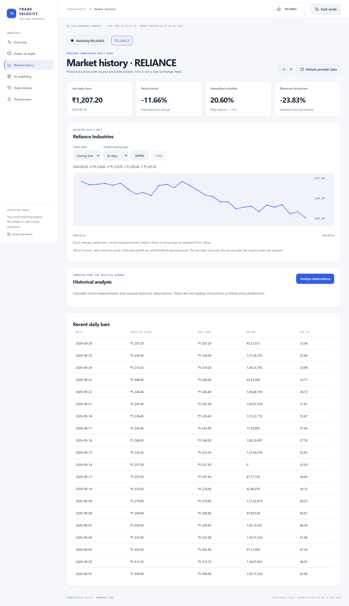

# TradeVelocity

We built TradeVelocity for our Advanced Data Structures and Algorithms project at Bennett University. It is a practice order book you can use: place a buy or sell order, see which order gets matched first, and inspect the trade that follows.

The app does **not** connect to a broker or move money or shares. Its order book contains only orders placed in your own practice workspace. The market-history screen uses dated daily data and is separate from that book.

[Open the live app](https://gettradevelocity.onrender.com) · [See the GitHub project page](https://sgshiv001.github.io/TRADE-VELOCITY/) · [Read the code](src/stock_engine/)



## Try a match

Create a trader account on the [web app](https://gettradevelocity.onrender.com), then open **Orders & depth**. The first-run guide explains the main screens; you can skip it and reopen it later.

For a quick example, place a sell limit order for **5 shares at ₹100**. Then place a buy limit order for **3 shares at ₹101**. The engine matches 3 shares at the resting sell order's ₹100 price. The other 2 sell shares stay on the book. You can check both the remaining order and the trade record in the app.

## What is inside

| Area | What you can do |
| --- | --- |
| Orders & depth | Place limit and market orders, inspect the best prices and depth, amend or cancel an open order. |
| Trade history | Search executions, export trades, and export or restore a practice session. |
| Market history | Explore dated daily bars, charts, volatility, drawdown, and RSI for eight supported companies. These are not live quotes. |
| AI watchdog | Review unusual patterns in your own executions. Its alerts are advisory and never block an order. |
| Performance | Compare the indexed order book with a list-based reference on an isolated workload. |

The matching engine uses heaps to reach the best price, AVL trees for ordered depth, FIFO queues for arrival order at a price, hash tables for direct lookup, and a Fenwick tree for traded-volume queries. The [architecture notes](docs/architecture.md) explain the choices and their limits.

## Use it on your device

| Platform | Link | What to expect |
| --- | --- | --- |
| Web | [Open TradeVelocity](https://gettradevelocity.onrender.com) | Trader accounts and saved workspaces backed by PostgreSQL. The free host may take a moment to wake up. |
| Windows | [Download the complete portable ZIP](https://github.com/sgshiv001/TRADE-VELOCITY/releases/download/v0.3.4/TradeVelocity-Windows-x64.zip) | Extract the whole ZIP and open `Launch_Desktop.vbs`. This unsigned build keeps its session on your PC. |
| Android | [Download the test APK](https://github.com/sgshiv001/TRADE-VELOCITY/releases/download/v1.0.1-android-test/TradeVelocity-Android-test.apk) | Debug-signed test build that opens the hosted app and needs internet access. |

The Windows ZIP passed a packaged smoke test on Windows 11. The Android APK was built with Android Studio and checked on an emulator. We have not yet checked the Windows ZIP on a second PC or the APK on a physical phone. Use the links above: the files attached to the older v1.0.0 release are incomplete or configured for a local server.

## Run it locally

You need Python 3.10+ and Node.js 22/npm. From the project folder in PowerShell:

```powershell
python -m venv .venv
.\.venv\Scripts\python.exe -m pip install -e ".[app,test]"
.\.venv\Scripts\python.exe app.py
```

The launcher builds the frontend and opens a local browser workspace. The [backend guide](docs/backend.md) covers database setup and the Android connection. The [Windows release guide](docs/windows-release.md) covers building the portable desktop package.

To run the checks:

```powershell
cd frontend
npm ci
npm run build
npm run test:e2e
cd ..
.\.venv\Scripts\python.exe -m pytest -q
```

Our [latest complete GitHub Actions run](https://github.com/sgshiv001/TRADE-VELOCITY/actions/runs/45381187499) passed the frontend build, PostgreSQL checks, browser checks on Linux and Windows, and Python checks on both platforms. We also checked the live signup, tutorial, a partial fill, saved trade history after sign-out and sign-in, market history, AI monitor, and a small isolated benchmark on 24 November 2026.

## Team

We are **Hash Syndicate**: Shivanshu Gupta, Aditya Verma, Sourabh Gupta, and Harshit Sharma. We developed and integrated the course project together. In our group presentation, we divided the explanation this way:

| Member | Presentation area |
| --- | --- |
| Shivanshu Gupta | Matching rules, fills, cancellations, and correctness checks |
| Aditya Verma | React interface, themes, order entry, and market views |
| Sourabh Gupta | Backend integration, saved sessions, workloads, and performance comparison |
| Harshit Sharma | AI monitoring, validation, tests, and documentation |

These are the areas recorded in our project report. They describe what each member presented, not exclusive ownership of files or commits. The [team page](docs/team.md) and [three-minute demo guide](docs/adsa-demo.md) have the short version for visitors and reviewers.

## More detail

[How the engine works](docs/architecture.md) · [Evaluation method and results](docs/evaluation.md) · [AI calibration and limits](docs/ai-calibration-report.md) · [Hosted workspace guide](docs/hosted-workspace.md) · [Project development log](docs/development-log.md)

The work is an educational simulation. It has no exchange connection, live quote feed, or certified fraud detection.

## License

[MIT](LICENSE)
