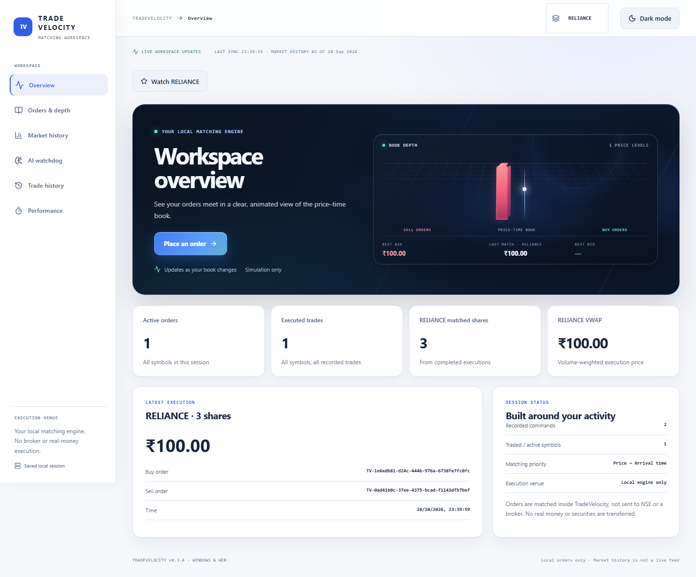

# TradeVelocity verification report

**Date:** 28 October 2026
**Version:** 0.3.4
**Environment:** Windows 11 x64 · Python 3.14.7 · Node.js 24.21.0 · npm 11.19.0
**Mode:** Headless browser and hidden Windows-app checks, using isolated test sessions.

## Results

| Check | Command | Result |
|---|---|---|
| Production frontend build | `cd frontend; npm run build` | **Passed** — TypeScript build and Vite production build; 1,749 modules transformed. |
| Python suite | `\.venv\Scripts\python.exe -m pytest -q` | **Passed** — 160 passed in 30.47 seconds. |
| Browser suite | `cd frontend; npm run test:e2e` | **Passed** — 13 Playwright checks in 31.4 seconds. |
| Packaged Windows smoke | `dist\TradeVelocity\TradeVelocity.exe --smoke-test` | **Passed** — hidden WebView rendered the app and completed matching, live-update, icon, startup, benchmark, and watchdog checks. |

The Windows smoke receipt is saved as [windows-smoke-receipt.json](windows-smoke-receipt.json). It records 7 shares matched in one trade, the native window icon, live workspace updates, startup handoff, watchdog calibration, and the high-volume regression check.

## Matching screenshot

The isolated browser session submitted a sell limit for 5 shares at ₹100, then a buy limit for 3 shares at ₹100. The engine executed 3 shares at the resting price and left 2 sell shares resting on the book.

[Trade history showing the recorded execution](screenshots/matching-trade-history.png)

## Screenshots

| File | Captured state |
|---|---|
| [matching-execution-overview.png](screenshots/matching-execution-overview.png) | Dashboard after a 3-share execution; 2 shares remain on the sell book. |
| [matching-trade-history.png](screenshots/matching-trade-history.png) | Trade history with the execution recorded. |
| [tradevelocity-overview-0.3.4.png](screenshots/tradevelocity-overview-0.3.4.png) | Overview with resting buy and sell orders in the 3D depth view. |
| [tradevelocity-overview-dark-0.3.4.png](screenshots/tradevelocity-overview-dark-0.3.4.png) | Same overview in dark mode. |
| [tradevelocity-desktop-launch-0.3.4.png](screenshots/tradevelocity-desktop-launch-0.3.4.png) | Windows desktop startup screen during local-engine connection. |
| [light-market.png](screenshots/light-market.png) | Historical market page in light mode. |
| [dark-market.png](screenshots/dark-market.png) | Historical market page in dark mode. |

## Coverage observed

- Matching, partial fills, price-time behavior, amendment/cancellation, persistence, exports/imports, and idempotent retry.
- Cross-tab live updates, rapid reconnection, access-gate UI, AI review persistence, and watchdog regression scenarios.
- Responsive browser layouts at 390, 820, and 1440 pixels.
- Packaged Windows startup, WebView rendering, matching, live updates, window icon, and calibrated watchdog checks.

Playwright and the browser screenshot capture used `scripts/browser_test_server.py`, which stores sessions in a temporary directory. The packaged smoke test used the separate `smoke-sessions`/`smoke-webview` profiles. Normal saved browser and desktop sessions were not used or cleared.

## Test-run note

An initial full run with system Python reported 157 passed, 1 skipped, and 1 failure in the launcher shutdown test. System Python caused `app.py` to delegate to the project venv as a child process; the test terminated only its parent, leaving the child holding the captured output pipe. I stopped that test-owned server and reran the full suite with the repository's documented `.venv` interpreter; all 160 tests passed. The Node runner also printed a `NO_COLOR`/`FORCE_COLOR` warning; the browser suite passed.

## Scope limits

These checks verify the local build and controlled test scenarios. They do not constitute testing on another physical PC, a signing check, a live broker connection, or real-market AI accuracy evaluation. The historical market screen uses the project's stored daily snapshot, dated 28 September 2026; it is not a live quote feed.

## Live demonstration: cross-tab updates and watchdog alert

A second isolated run verified the live flow through the running local server. Two browser tabs connected to the workspace WebSocket. A sell order appeared in the observer tab; a compatible buy executed 3 shares at ₹100, and the observer tab updated its executed-trade count from the received WebSocket change event. Two WebSocket change frames were observed.

A separate session then recorded 45 baseline executions and a 5,000-share outlier. The watchdog reported 46 observations, 40 baseline observations, and 6 scored observations. The `LIVE-LARGE-BUY` alert appeared in the UI with `robust_guard` and `size_envelope` detectors. This verifies the alert workflow on a controlled scenario, not real-market fraud accuracy.

- [Live demo evidence JSON](live-demo-evidence.json)
- [Dashboard screenshot after the WebSocket-updated match](screenshots/live-websocket-dashboard.png)
- [Watchdog UI screenshot with the live alert](screenshots/live-watchdog-monitor.png)

The live demo used a temporary isolated test store and the server was stopped after capture.
